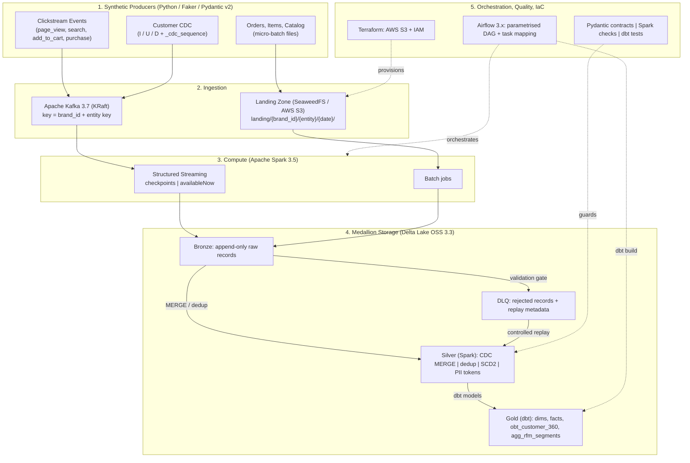

# Multi-Tenant CRM Lakehouse Platform

[-orange?style=flat)](docs/PROGRESS.md)
[](https://www.python.org/)
[](https://www.docker.com/)
[](https://spark.apache.org/)
[-231F20?style=flat&logo=apachekafka&logoColor=white)](https://kafka.apache.org/)
[](https://delta.io/)
[](https://www.getdbt.com/)
[](https://airflow.apache.org/)
[](docs/adr/0011-aws-glue-instead-of-emr-serverless.md)
[-FF3621?style=flat&logo=databricks&logoColor=white)](docs/adr/0012-databricks-free-edition-track.md)

> **A local-first, multi-tenant streaming lakehouse:** Kafka → Spark Structured Streaming → Delta Lake (Bronze / Silver) → dbt (Gold).  
> Built around **correctness under failure** — duplicate delivery, out-of-order CDC, late events, schema drift, restarts and cross-tenant leakage — and around proving it with tests rather than claims.

> [!IMPORTANT]
> **Project status: early development — re-planned 2026-11-05, Milestone 1 of 3 starting.** The local Docker stack definition and a first generator configuration exist but are **not yet verified**; everything else below is **planned**. Every section is marked ✅ Implemented · 🔄 In progress · 📋 Planned. Live tracker: [docs/PROGRESS.md](docs/PROGRESS.md).

> [!NOTE]
> **Data**: All data is **fully synthetic**, produced by `src/generator/` (Faker + Pydantic v2). The entity model is inspired by the *TheLook* e-commerce domain (hence the repository name) and reshaped into a multi-brand CRM event model. No real company or customer data is used.

---

## 1. What This Project Demonstrates

**Scenario (synthetic):** a CRM / loyalty data platform serving several retail brands (tenants) from one shared lakehouse.

The engineering questions it answers:

| Question | Approach | Status |
|---|---|---|
| How do you turn at-least-once streams into idempotent tables? | Spark checkpoints + `foreachBatch` `MERGE` on deterministic keys; restart & replay tests | 📋 |
| How do you apply out-of-order CDC and keep history? | Sequence-ordered merge (`_cdc_sequence`), Spark-owned SCD Type 2 | 📋 |
| How do you prevent cross-tenant leakage in shared tables — and prove it? | `brand_id` in every key/join, deliberate key collisions, negative tests | 📋 |
| How do you quarantine bad records without losing them? | Two-stage DLQ, reconciliation against a ground-truth manifest, controlled replay | 📋 |
| What changes between local and cloud? | Shared logic, thin environment adapters, per-environment test reports | 📋 |

---

## 2. Implementation Status

| Component | Status | Evidence / Location |
|---|---|---|
| Local stack definition: Kafka (KRaft), SeaweedFS, Spark, PostgreSQL, Airflow | 🔄 defined, not verified; rebuild to Python 3.11 / Spark 3.5.9 planned (W1.D2) | [docker-compose.yml](docker-compose.yml) |
| Generator configuration (`pydantic-settings`) | 🔄 v1, to be aligned with contracts (W1.D3) | [src/generator/config.py](src/generator/config.py) |
| Data contracts, deterministic generator, keyed idempotent Kafka producer, CI | 📋 | Week 1 |
| Bronze streaming, restart tests, DLQ, metastore + dbt spike | 📋 | Week 2 |
| Silver: CDC MERGE, SCD2, dedup, reconciliation, tenant-isolation tests | 📋 | Week 3 |
| dbt Gold (Customer 360, RFM), Airflow 3 pipeline | 📋 | Week 4 |
| Terraform AWS foundation, same jobs on AWS Glue 5.0, CI/CD via OIDC | 📋 | Week 5 |
| Privacy erasure; Databricks (Unity Catalog, jobs, dbt, dashboard); release | 📋 | Week 6 |

---

## 3. Target Architecture



Full design, invariants and scope tiers: [docs/PROJECT_CHARTER.md](docs/PROJECT_CHARTER.md).

---

## 4. Key Design Decisions

### Delivery semantics (no blanket "exactly-once" claim)
| Stage | Guarantee |
|---|---|
| Generator → Kafka | At-least-once (idempotent producer; business duplicates injected on purpose) |
| Kafka → Bronze | Each offset committed once per checkpoint lineage (Spark checkpoint + Delta sink) |
| Bronze → Silver | Idempotent outcome — re-running a batch yields the same state |
| Checkpoint loss | Replay from Kafka; Silver `MERGE` absorbs re-reads (verified by test) |

### Multi-tenancy
Tenants share tables. `brand_id` is mandatory and part of every key and join. Partitioning is a performance choice, **not** a security boundary; isolation is demonstrated with tests that inject cross-tenant key collisions, including a negative test proving that a leaky join is caught.

### Ownership
Spark/Delta owns Bronze, DLQ and Silver (including SCD2 history). dbt owns Gold only and never writes Silver.

### Privacy controls
Emails are pseudonymised with **keyed HMAC-SHA256** in Silver (plain SHA-256 of low-entropy values is dictionary-reversible); phones are masked; raw PII never reaches Gold. An audited erasure procedure covers Bronze, Silver, Gold, time travel and `VACUUM`. This demonstrates privacy controls; it is **not** a legal compliance claim.

---

## 5. Local vs. Cloud: What Is Shared, What Differs

| Layer | Local ($0) | AWS (Extended / Stretch) | What actually differs |
|---|---|---|---|
| Infrastructure | [docker-compose.yml](docker-compose.yml) (profiles) | Terraform (`infra/terraform/`), destroyed after each cloud session | Provisioning model, cost |
| Object storage | SeaweedFS (S3-compatible API) | AWS S3 (SSE, lifecycle rules) | IAM, encryption, listing/error behaviour; endpoint config isolated in settings |
| Streaming | Kafka 3.7 (KRaft) | Not deployed in v1 | Kinesis is compared in ADR-0002 only |
| Compute | OSS Spark 3.5.9 standalone (Python 3.11) | AWS Glue 5.0 (Spark 3.5.4, Python 3.11); Databricks serverless (Free Edition) | Runtime build, credentials (IAM role / workspace identity), logging |
| Catalog | Hive metastore on PostgreSQL | AWS Glue Data Catalog; Unity Catalog on Databricks | Catalog client configuration, three-level namespace |
| Table format | Delta Lake OSS 3.3.3 | Delta 3.3.0 on Glue 5.0; Databricks Delta | Patch-level and feature differences recorded |
| Transformation | dbt-spark via Spark Thrift Server | dbt-databricks on a SQL warehouse; Athena for ad-hoc SQL on AWS | Same models, second adapter |

Business logic is shared; environment specifics live in configuration and thin adapters. Results are reported **per environment**.

---

## 6. Medallion Layers (Planned)

```
Landing (S3) ──> Bronze (append-only) ──> Silver (CDC, dedup, SCD2) ──> Gold (dbt marts)
                    │       ▲
                    └─> DLQ ┘  (controlled replay)
```

### 🥉 Bronze — Append-Only Raw Records 📋
- No `UPDATE` / `DELETE` in normal processing; the only exception is the audited privacy erasure procedure.
- Malformed payloads are stored raw with `_parse_error` — never discarded.
- Metadata: `_ingest_ts`, `_source_ref` (file URI or Kafka topic/partition/offset), `_batch_id`, `brand_id`.

### 🥈 Silver — Conformed State & History 📋
**Sequence-ordered CDC merge** (illustrative; column lists abbreviated):

```sql
MERGE INTO silver.customers AS t
USING (
  -- keep only the latest event per key in this micro-batch,
  -- otherwise MERGE fails on multiple source matches
  SELECT * FROM (
    SELECT *, ROW_NUMBER() OVER (
      PARTITION BY brand_id, customer_id ORDER BY _cdc_sequence DESC) AS rn
    FROM cdc_batch
  ) WHERE rn = 1
) AS s
ON  t.brand_id = s.brand_id
AND t.customer_id = s.customer_id
WHEN MATCHED AND s._cdc_sequence > t._cdc_sequence AND s._cdc_action = 'D' THEN
  UPDATE SET t.is_deleted = true, t.email_token = NULL, t.phone_masked = NULL,
             t._cdc_sequence = s._cdc_sequence
WHEN MATCHED AND s._cdc_sequence > t._cdc_sequence THEN
  UPDATE SET t.city = s.city, t.loyalty_tier = s.loyalty_tier, t.is_deleted = false,
             t._cdc_sequence = s._cdc_sequence  -- ...
WHEN NOT MATCHED AND s._cdc_action <> 'D' THEN
  INSERT (brand_id, customer_id, city, loyalty_tier, _cdc_sequence /* ... */)
  VALUES (s.brand_id, s.customer_id, s.city, s.loyalty_tier, s._cdc_sequence /* ... */);
```

- Stale events (`_cdc_sequence ≤` current) never overwrite newer state; duplicates are no-ops.
- **SCD Type 2** history (`silver.customers_history`: `valid_from`, `valid_to`, `is_current`) is built by Spark from the CDC log — a single source of truth, no dbt snapshots.
- Orders / clickstream are deduplicated on `(brand_id, <id>)`; orphan foreign keys are quarantined as *retryable* and re-evaluated on replay.

### 🥇 Gold — dbt Marts 📋
- Kimball `dim_*` / `fct_*` models, `obt_customer_360`, `agg_rfm_segments` (NTILE-based RFM).
- Composite-key (`brand_id`, key) relationship tests; tenant-scoped consumption views.
- Churn-risk feature mart: Stretch.

---

## 7. Data Quality & DLQ (Planned)

- **Two stages**: parse failures captured at Bronze ingest; contract / integrity failures captured at the Bronze → Silver gate.
- **Reconciliation**: per batch, `bronze = silver_accepted + dlq + duplicates_removed + late_beyond_window`, checked against the generator's ground-truth manifest of injected defects.
- **Replay**: fixed records are re-processed with their original `event_id`; replaying twice does not duplicate Silver.

```json
{
  "_dlq_id": "8f3b1e72-51a8-43d9-95a2-c128f73b64bc",
  "brand_id": "brand_alpha",
  "_bronze_ref": "bronze.raw_orders@batch=42/file=part-0003.json/row=118",
  "_error_category": "REFERENTIAL_INTEGRITY_VIOLATION",
  "_rejection_reason": "customer_id '9f82d1c0-...' not found in silver.customers for brand_alpha",
  "_retryable": true,
  "_rejected_at": "2026-10-20T02:15:30.124Z",
  "_pipeline_run_id": "<run id>",
  "_replay_status": "PENDING",
  "_replay_count": 0
}
```

---

## 8. Orchestration (Planned — Extended)

- Apache Airflow 3.x: one **parametrised DAG** using dynamic task mapping over the configured tenant list (no per-tenant DAG generation).
- Airflow triggers Spark jobs (`Trigger.availableNow` micro-batches) and `dbt build`; it does not host long-running streams — Spark owns checkpoints and stream lifecycle.
- Quality gates (reconciliation, DLQ-rate thresholds per brand), tenant failure isolation, webhook alerts.

---

## 9. Local Quickstart

### What works today ✅

**Prerequisites**
- [Docker Desktop](https://www.docker.com/products/docker-desktop/) with Docker Compose v2
- Python 3.11+, Git
- Memory: running Kafka, Spark, Airflow, PostgreSQL and SeaweedFS together likely needs **≥ 8 GB RAM allocated to Docker** — *to be confirmed by a clean-machine measurement*.

```bash
git clone https://github.com/dogruom/thelook-lakehouse-platform.git
cd thelook-lakehouse-platform
python scripts/bootstrap_env.py   # planned (W1.D2): creates .env with random local secrets

# Start only what you need (profiles: core, sql, orchestration, tools)
docker compose --profile core up -d
docker compose ps

# Infrastructure smoke test (topics, buckets, metastore DB, Delta round trip)
python scripts/smoke_test.py
```

| Service | Local URL | Credentials |
|---|---|---|
| Apache Airflow (`orchestration`) | http://localhost:8080 | from your `.env` |
| Spark Master UI | http://localhost:8181 | — |
| SeaweedFS S3 API | http://localhost:9000 | from your `.env` |
| SeaweedFS Filer | http://localhost:9001 | — |
| Kafka broker | `localhost:9094` | — |

All ports are published on `127.0.0.1` only (W1.D2). Secrets never appear in tracked files.

### Pipeline run 📋 (planned — commands become valid as components land)

```bash
python -m venv .venv
source .venv/bin/activate  # Windows: .venv\Scripts\activate
pip install -r requirements/dev.txt

pip install -e .[dev]
python -m lakehouse.generator produce --events 5000
python scripts/run_e2e.py          # planned (W4.D24): generate → Bronze → Silver → dbt
```

---

## 10. Testing Strategy & CI (Planned)

| Suite | Runs where | Scope |
|---|---|---|
| Unit | Offline, every PR | Generators, contracts, pure transformation functions |
| Correctness (integration) | Docker profile, PRs to `main` | Restart/replay, CDC ordering, tenant isolation, DLQ replay, reconciliation |
| dbt | CI | `dbt compile`; `dbt build` in integration profile |
| Static | Every PR | `ruff check`, `ruff format --check`, `mypy` |

```bash
pytest tests/unit/ -v --cov=src --cov-report=term-missing
ruff check src/ tests/ && ruff format --check src/ tests/
mypy src/
```

A CI badge will be added after the first green workflow run.

---

## 11. Repository Layout (Target)

> Most paths below are **planned**; see the status table in §2 for what exists today.

```
thelook-lakehouse-platform/
├── .github/workflows/ci.yml       # CI: lint, types, unit tests, integration job, dbt compile
├── dags/                          # Airflow: parametrised multi-tenant pipeline
├── dbt_project/                   # dbt Core Gold models (reads Silver, writes Gold)
│   └── models/{staging,intermediate,marts}/
├── docker/                        # Container definitions
├── docs/
│   ├── PROJECT_CHARTER.md         # Scope tiers, invariants, design
│   ├── DATA_CONTRACTS.md          # Schemas, dirty-data budgets, DLQ specs
│   ├── ENGINEERING_STANDARDS.md   # Coding, Spark, dbt, Airflow, Git standards
│   ├── DELIVERY_PLAN.md           # 6-week execution plan
│   ├── PROGRESS.md                # Sprint tracker with evidence
│   └── adr/                       # Architecture Decision Records
├── infra/terraform/               # AWS: S3, Glue Catalog + jobs, IAM/OIDC, Budgets
├── databricks/                    # Asset Bundle, Unity Catalog grants (W6)
├── scripts/                       # smoke_test.py, init scripts, DLQ replay, backfill
├── src/lakehouse/                 # one package, independent components (ADR-0009)
│   ├── contracts/                 # versioned event & table schemas (shared interface)
│   ├── common/                    # settings, logging, Spark/storage adapters
│   ├── generator/                 # synthetic data + Kafka producer + landing writer
│   ├── ingestion/                 # Bronze stream + batch jobs
│   ├── quality/                   # validation gate, DLQ, replay, reconciliation
│   ├── silver/                    # CDC MERGE, SCD2, dedup jobs
│   └── ops/                       # erasure, metrics report
├── tests/{unit,spark,integration}/
├── docker-compose.yml
└── pyproject.toml
```

---

## 12. Future Work (Out of Scope for v1)

- Kinesis adapter behind the common event envelope (compared in ADR-0002).
- Reverse ETL / operational triggers (e.g. webhook to marketing tools).
- BI dashboard on Gold marts.
- Managed Airflow, Kubernetes deployment.
- dbt Gold on Snowflake or BigQuery; Databricks Auto Loader and paid-tier features.
- Schema Registry (Avro/Protobuf) behind the event contracts; Spark 4 / Delta 4 upgrade.

---

## 📚 Documentation

- 📋 [Project Charter — scope, invariants, design](docs/PROJECT_CHARTER.md)
- 📐 [Data Contracts & Entity Schemas](docs/DATA_CONTRACTS.md)
- 🛠️ [Engineering Standards](docs/ENGINEERING_STANDARDS.md)
- 📅 [Delivery Plan — three two-week milestones](docs/DELIVERY_PLAN.md)
- 📊 [Progress Tracker](docs/PROGRESS.md)
- 🏛️ ADRs: [0001 SeaweedFS](docs/adr/0001-local-object-storage-seaweedfs.md) · [0007 Runtime, catalog, Gold engine](docs/adr/0007-runtime-catalog-and-gold-engine.md) · [0008 AWS target and cost guardrails](docs/adr/0008-aws-target-emr-serverless-and-cost-guardrails.md) · [0009 Component boundaries](docs/adr/0009-component-boundaries-and-contracts.md) · [0011 AWS Glue](docs/adr/0011-aws-glue-instead-of-emr-serverless.md) · [0012 Databricks track](docs/adr/0012-databricks-free-edition-track.md)
- 🧭 Developer guides: [Git quick reference](docs/GIT_CHEATSHEET.md) · [Claude Code workflow](docs/CLAUDE_CODE_CHEATSHEET.md)

---

## 🤖 Engineering Workflow

Developed with Claude Code as an AI pair-programmer under explicit controls: a coordinator session plans each task, separate implementation and test-authoring agents work on disjoint files, an independent read-only reviewer gates acceptance, and an evidence auditor checks that every ✅ in [PROGRESS](docs/PROGRESS.md) has a commit and verification output. Configuration: [CLAUDE.md](CLAUDE.md), [.claude/](.claude/).

---

## 👤 Author

**Ömer Faruk Doğru**  
Senior Data / Analytics Engineer — Berlin, Germany  
- **Email**: [dogruomerfaruk@outlook.com](mailto:dogruomerfaruk@outlook.com)  
- **LinkedIn**: [linkedin.com/in/omer-faruk-dogru-2020d/](https://linkedin.com/in/omer-faruk-dogru-2020d/)  
- **GitHub**: [github.com/dogruom](https://github.com/dogruom)
