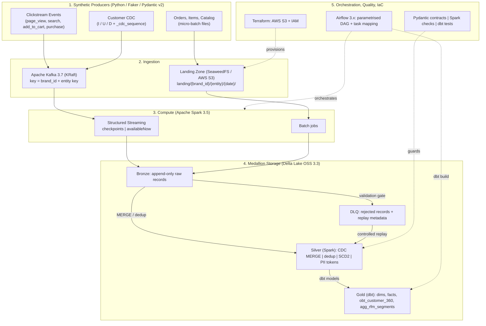

# Multi-Tenant CRM Lakehouse Platform

[](docs/PROGRESS.md)
[](https://www.python.org/)
[](https://www.docker.com/)
[](https://spark.apache.org/)
[-231F20?style=flat&logo=apachekafka&logoColor=white)](https://kafka.apache.org/)
[](https://delta.io/)
[](https://www.getdbt.com/)
[](https://airflow.apache.org/)
[](docs/adr/0011-aws-glue-instead-of-emr-serverless.md)
[-FF3621?style=flat&logo=databricks&logoColor=white)](docs/adr/0012-databricks-free-edition-track.md)

> **A local-first, multi-tenant streaming lakehouse:** Kafka → Spark Structured Streaming → Delta Lake (Bronze / Silver) → dbt (Gold).  
> Built around **correctness under failure** — duplicate delivery, out-of-order CDC, late events, schema drift, restarts and cross-tenant leakage — and around proving it with tests rather than claims.

> [!IMPORTANT]
> **Project status: Milestone 1 of 3 technically complete (`v0.1.0` tag pending, owner); Milestones 2–3 planned.** Milestone 1 covers the local stack, data contracts, a deterministic generator with a ground-truth manifest, a keyed Kafka producer, Kafka → Bronze streaming with tested restart and checkpoint-loss behaviour, a first DLQ gate, and tables registered by name in a metastore. Silver, Gold, Airflow, AWS and Databricks are **planned**. Every section is marked ✅ Implemented (commit and verification output in [docs/PROGRESS.md](docs/PROGRESS.md)) · 🔄 In progress · 📋 Planned.

> [!NOTE]
> **Data**: All data is **fully synthetic**, produced by `src/lakehouse/generator/` (Faker + Pydantic v2). The entity model is inspired by the *TheLook* e-commerce domain (hence the repository name) and reshaped into a multi-brand CRM event model. No real company or customer data is used.

---

## 1. What This Project Demonstrates

**Scenario (synthetic):** a CRM / loyalty data platform serving several retail brands (tenants) from one shared lakehouse.

The engineering questions it answers:

| Question | Approach | Status |
|---|---|---|
| How do you turn at-least-once streams into idempotent tables? | Spark checkpoints + `foreachBatch` `MERGE` on deterministic keys; restart & replay tests | 🔄 Bronze restart and checkpoint-loss tests ✅; Silver `MERGE` 📋 |
| How do you apply out-of-order CDC and keep history? | Sequence-ordered merge (`_cdc_sequence`), Spark-owned SCD Type 2 | 📋 |
| How do you prevent cross-tenant leakage in shared tables — and prove it? | `brand_id` in every key/join, deliberate key collisions, negative tests | 🔄 composite Kafka keys and generator collisions ✅; Silver isolation tests 📋 |
| How do you quarantine bad records without losing them? | Two-stage DLQ, reconciliation against a ground-truth manifest, controlled replay | 🔄 parse errors kept in Bronze and DLQ gate matched to the manifest ✅; Silver-stage DLQ and replay 📋 |
| What changes between local and cloud? | Shared logic, thin environment adapters, per-environment test reports | 📋 |

---

## 2. Implementation Status

Hashes refer to commits in [docs/PROGRESS.md](docs/PROGRESS.md), which holds the verification output for each task.

| Component | Status | Code | Evidence |
|---|---|---|---|
| Python 3.11 baseline, ruff, mypy, import-linter, pre-commit, CI job 1 | ✅ | [pyproject.toml](pyproject.toml), [ci.yml](.github/workflows/ci.yml) | `00df04e`, `14a6a20` |
| Local stack: Kafka (KRaft), SeaweedFS, Spark 3.5.9 / Delta 3.3.3, PostgreSQL; smoke test | ✅ | [docker-compose.yml](docker-compose.yml), [scripts/smoke_test.py](scripts/smoke_test.py) | `f896e02` (24/24 checks) |
| Data contracts v1 (envelope, CDC, clickstream, order, product) + JSON Schemas | ✅ | [src/lakehouse/contracts/](src/lakehouse/contracts/) | `6889317` |
| Deterministic CDC generator with exact-count defects and manifest | ✅ | [src/lakehouse/generator/](src/lakehouse/generator/) | `848d9c8` |
| Clickstream generator, keyed idempotent Kafka producer, round-trip test | ✅ | [producer.py](src/lakehouse/generator/producer.py) | `03d02b4` |
| Spark session factory, in-container test runner, job submit script | ✅ | [src/lakehouse/common/](src/lakehouse/common/), [scripts/submit_job.py](scripts/submit_job.py) | `e82f91b`, `5836709`, `80a6e63` |
| Kafka → Bronze streaming (append-only, lineage, `_parse_error`) | ✅ | [src/lakehouse/ingestion/](src/lakehouse/ingestion/) | `b67f155`, `78f3d60` |
| Restart and checkpoint-loss tests; delivery semantics ADR (draft) | ✅ | [test_stream_restart.py](tests/integration/test_stream_restart.py), [ADR-0006](docs/adr/0006-delivery-semantics-restart-and-checkpoint-loss.md) | `c23e322` |
| Validation gate and DLQ for stream entities, matched to the manifest | ✅ | [src/lakehouse/quality/](src/lakehouse/quality/) | `5f64ad4` |
| Hive metastore on PostgreSQL, tables by name; dbt-spark capability spike | ✅ | [tables.py](src/lakehouse/common/tables.py), [dbt_project/models/spike/](dbt_project/models/spike/), [ADR-0004](docs/adr/0004-spark-dbt-ownership-and-adapter-capabilities.md) | `f2f07f9` |
| Batch landing and Bronze batch ingest; Silver CDC `MERGE`, SCD2, reconciliation, tenant-isolation tests | 📋 | `src/lakehouse/silver/` (empty) | Milestone 2, Week 3 |
| dbt Gold (Customer 360, RFM), Airflow 3 pipeline | 📋 | `dbt_project/`, `dags/` | Milestone 2, Week 4 |
| Terraform AWS foundation, same jobs on AWS Glue 5.0, CI/CD via OIDC | 📋 | | Milestone 3, Week 5 |
| Privacy erasure; Databricks (Unity Catalog, jobs, dbt, dashboard) | 📋 | | Milestone 3, Week 6 |

Airflow and Thrift Server services are defined in Compose profiles; Airflow is not used by any delivered job.

---

## What Milestone 1 Can and Cannot Claim

| Can claim (with evidence) | Evidence |
|---|---|
| Kafka keys are `{brand_id}:{entity_id}` with a `brand_id` header; one partition per key, asserted against the Java murmur2 partitioner | [test_producer_roundtrip.py](tests/integration/test_producer_roundtrip.py) |
| At-least-once producer; checkpointed Bronze where each `(topic, partition, offset)` appears once per checkpoint lineage after a restart | [test_stream_restart.py](tests/integration/test_stream_restart.py), [ADR-0006](docs/adr/0006-delivery-semantics-restart-and-checkpoint-loss.md) |
| After a full checkpoint loss, re-reads are counted and reported, not hidden; a partial loss is detected and the job fails instead of losing data | [test_stream_restart.py](tests/integration/test_stream_restart.py) (S5, S9), [test_bronze_rewound.py](tests/spark/test_bronze_rewound.py) |
| Bronze rows equal produced messages, parse errors included; the DLQ set equals the manifest's DLQ set exactly, so nothing is silently lost up to the DLQ stage | [test_bronze_stream.py](tests/integration/test_bronze_stream.py), [test_dlq_reconciliation.py](tests/integration/test_dlq_reconciliation.py) |
| Tables resolve by name through the metastore; dbt-spark capabilities were probed and the Thrift adapter was kept | [ADR-0004](docs/adr/0004-spark-dbt-ownership-and-adapter-capabilities.md) |

**Not claimed:** end-to-end exactly-once delivery · Silver or SCD2 correctness · Gold models · cloud runs (AWS, Databricks) · performance numbers · behaviour at scale (runs use a few thousand events on one local machine).

---

## 3. Target Architecture



Full design, invariants and scope tiers: [docs/PROJECT_CHARTER.md](docs/PROJECT_CHARTER.md).

---

## 4. Key Design Decisions

### Delivery semantics (no blanket "exactly-once" claim)
| Stage | Guarantee |
|---|---|
| Generator → Kafka | At-least-once (idempotent producer; business duplicates injected on purpose) ✅ |
| Kafka → Bronze | Each offset committed once per checkpoint lineage (Spark checkpoint + Delta sink) ✅ tested in [ADR-0006](docs/adr/0006-delivery-semantics-restart-and-checkpoint-loss.md) |
| Bronze → Silver | Idempotent outcome — re-running a batch yields the same state 📋 |
| Checkpoint loss | Replay from Kafka; re-reads are counted in Bronze ✅; Silver `MERGE` absorbing them 📋 |

### Multi-tenancy
Tenants share tables. `brand_id` is mandatory and part of every key and join. Partitioning is a performance choice, **not** a security boundary; isolation is to be demonstrated with tests. Delivered in M1 ✅: the generator injects a cross-tenant key collision and the Kafka key, header and DLQ MERGE carry `brand_id`. Planned 📋 (M2): Silver/Gold collision tests, including a negative test proving that a leaky join is caught.

### Ownership
Spark/Delta owns Bronze, DLQ and Silver (including SCD2 history). dbt owns Gold only and never writes Silver.

### Privacy controls (design intent — 📋 Silver in M2, erasure in M3)
Delivered in M1 ✅: jobs log codes and counts only, never payload values. Planned: emails pseudonymised with **keyed HMAC-SHA256** in Silver (plain SHA-256 of low-entropy values is dictionary-reversible); phones are masked; raw PII never reaches Gold. A planned audited erasure procedure rewrites Bronze, Silver and Gold; `VACUUM` only removes old files afterwards and is not erasure by itself. This demonstrates privacy controls; it is **not** a legal compliance claim.

---

## 5. Local vs. Cloud: What Is Shared, What Differs

| Layer | Local ($0) | AWS (Extended / Stretch) | What actually differs |
|---|---|---|---|
| Infrastructure | [docker-compose.yml](docker-compose.yml) (profiles) | Terraform (`infra/terraform/`), destroyed after each cloud session | Provisioning model, cost |
| Object storage | SeaweedFS (S3-compatible API) | AWS S3 (SSE, lifecycle rules) | IAM, encryption, listing/error behaviour; endpoint config isolated in settings |
| Streaming | Kafka 3.7 (KRaft) | Not deployed in v1 | Kinesis is compared in ADR-0002 only |
| Compute | OSS Spark 3.5.9 standalone (Python 3.11) | AWS Glue 5.0 (Spark 3.5.4, Python 3.11); Databricks serverless (Free Edition) | Runtime build, credentials (IAM role / workspace identity), logging |
| Catalog | Hive metastore on PostgreSQL | AWS Glue Data Catalog; Unity Catalog on Databricks | Catalog client configuration, three-level namespace |
| Table format | Delta Lake OSS 3.3.3 | Delta 3.3.0 on Glue 5.0; Databricks Delta | Patch-level and feature differences recorded |
| Transformation | dbt-spark via Spark Thrift Server | dbt-databricks on a SQL warehouse; Athena for ad-hoc SQL on AWS | Same models, second adapter |

Business logic is shared; environment specifics live in configuration and thin adapters. Results are reported **per environment**.

---

## 6. Medallion Layers (partly delivered)

```
Landing (S3) ──> Bronze (append-only) ──> Silver (CDC, dedup, SCD2) ──> Gold (dbt marts)
                    │       ▲
                    └─> DLQ ┘  (controlled replay)
```

### 🥉 Bronze — Append-Only Raw Records ✅ (stream path; batch path 📋)
- ✅ Append-only writes from Kafka (`raw_customers`, `raw_clickstream`); no `UPDATE` / `DELETE` in normal processing.
- ✅ Malformed payloads are stored raw with `_parse_error` — never discarded.
- ✅ Metadata: `_raw_value`, `_ingest_ts`, `_source_ref` (Kafka topic/partition/offset), `_batch_id`, `brand_id`.
- ✅ A rewound checkpoint is detected and fails the job instead of losing rows silently.
- 📋 File-based batch ingest (`_source_ref` = file URI) and the audited privacy erasure procedure.
- Code: [bronze.py](src/lakehouse/ingestion/bronze.py), [bronze_stream.py](src/lakehouse/ingestion/jobs/bronze_stream.py) (`78f3d60`, `c23e322`).

### 🥈 Silver — Conformed State & History 📋
**Sequence-ordered CDC merge** (illustrative; column lists abbreviated):

```sql
MERGE INTO silver.customers AS t
USING (
  -- keep only the latest event per key in this micro-batch,
  -- otherwise MERGE fails on multiple source matches
  SELECT * FROM (
    SELECT *, ROW_NUMBER() OVER (
      PARTITION BY brand_id, customer_id ORDER BY _cdc_sequence DESC) AS rn
    FROM cdc_batch
  ) WHERE rn = 1
) AS s
ON  t.brand_id = s.brand_id
AND t.customer_id = s.customer_id
WHEN MATCHED AND s._cdc_sequence > t._cdc_sequence AND s._cdc_action = 'D' THEN
  UPDATE SET t.is_deleted = true, t.email_token = NULL, t.phone_masked = NULL,
             t._cdc_sequence = s._cdc_sequence
WHEN MATCHED AND s._cdc_sequence > t._cdc_sequence THEN
  UPDATE SET t.city = s.city, t.loyalty_tier = s.loyalty_tier, t.is_deleted = false,
             t._cdc_sequence = s._cdc_sequence  -- ...
WHEN NOT MATCHED AND s._cdc_action <> 'D' THEN
  INSERT (brand_id, customer_id, city, loyalty_tier, _cdc_sequence /* ... */)
  VALUES (s.brand_id, s.customer_id, s.city, s.loyalty_tier, s._cdc_sequence /* ... */);
```

- Stale events (`_cdc_sequence ≤` current) never overwrite newer state; duplicates are no-ops.
- **SCD Type 2** history (`silver.customers_history`: `valid_from`, `valid_to`, `is_current`) is built by Spark from the CDC log — a single source of truth, no dbt snapshots.
- Orders / clickstream are deduplicated on `(brand_id, <id>)`; orphan foreign keys are quarantined as *retryable* and re-evaluated on replay.

### 🥇 Gold — dbt Marts 📋
- Kimball `dim_*` / `fct_*` models, `obt_customer_360`, `agg_rfm_segments` (NTILE-based RFM).
- Composite-key (`brand_id`, key) relationship tests; tenant-scoped consumption views.
- Churn-risk feature mart: Stretch.

---

## 7. Data Quality & DLQ (partly delivered)

- **Two stages**: parse failures captured at Bronze ingest ✅; contract / integrity failures captured at a validation gate ✅ for CDC and clickstream (rule codes, `_error_category`, `_bronze_ref`, `_retryable`, `_replay_status`); the DLQ is written by an insert-only `MERGE` on `_dlq_id`, so a rerun inserts 0 rows ✅. Referential-integrity checks against Silver 📋.
- **Reconciliation**: the DLQ set equals the generator's ground-truth manifest DLQ set exactly ✅ ([test](tests/integration/test_dlq_reconciliation.py), `5f64ad4`). The full per-batch identity `bronze = silver_accepted + dlq + duplicates_removed + late_beyond_window` needs Silver 📋.
- **Replay**: fixed records re-processed with their original `event_id`; replaying twice does not duplicate Silver 📋.

Illustrative target envelope (the delivered gate writes the fields above; the example category belongs to the planned Silver stage):

```json
{
  "_dlq_id": "8f3b1e72-51a8-43d9-95a2-c128f73b64bc",
  "brand_id": "brand_alpha",
  "_bronze_ref": "bronze.raw_orders@batch=42/file=part-0003.json/row=118",
  "_error_category": "REFERENTIAL_INTEGRITY_VIOLATION",
  "_rejection_reason": "customer_id '9f82d1c0-...' not found in silver.customers for brand_alpha",
  "_retryable": true,
  "_rejected_at": "2026-10-20T02:15:30.124Z",
  "_pipeline_run_id": "<run id>",
  "_replay_status": "PENDING",
  "_replay_count": 0
}
```

---

## 8. Orchestration (Planned — Extended)

- Apache Airflow 3.x: one **parametrised DAG** using dynamic task mapping over the configured tenant list (no per-tenant DAG generation).
- Airflow triggers Spark jobs (`Trigger.availableNow` micro-batches) and `dbt build`; it does not host long-running streams — Spark owns checkpoints and stream lifecycle.
- Quality gates (reconciliation, DLQ-rate thresholds per brand), tenant failure isolation, webhook alerts.

---

## 9. Local Quickstart

### What works today ✅

**Prerequisites**
- [Docker Desktop](https://www.docker.com/products/docker-desktop/) with Docker Compose v2
- Python 3.11, Git
- Memory: Docker had 7.6 GB allocated during development; the `core` services used about 0.9 GiB in the smoke test (see [PROGRESS.md](docs/PROGRESS.md), W1.D2). A clean-machine measurement is still outstanding.

```powershell
git clone https://github.com/dogruom/thelook-lakehouse-platform.git
cd thelook-lakehouse-platform
py -3.11 -m venv .venv; .\.venv\Scripts\Activate.ps1; pip install -e .[dev]
python scripts/bootstrap_env.py   # creates the local env file with random secrets; never overwrites

# Start only what you need (profiles: core, sql, orchestration, tools)
docker compose --profile core up -d
python scripts/smoke_test.py      # topics, buckets, metastore DB, Delta round trip
```

| Service | Local URL | Credentials |
|---|---|---|
| Apache Airflow (`orchestration`; defined, not used by M1 jobs) | http://localhost:8080 | from your local env file |
| Spark Master UI | http://localhost:8181 | — |
| SeaweedFS S3 API | http://localhost:9000 | from your `.env` |
| SeaweedFS Filer | http://localhost:9001 | — |
| Kafka broker | `localhost:9094` | — |

All ports are published on `127.0.0.1` only (W1.D2). Secrets never appear in tracked files.

### Milestone 1 pipeline run ✅

Full walkthrough with expected output: [docs/runbooks/m1-streaming-demo.md](docs/runbooks/m1-streaming-demo.md). Step-by-step map of the code: [docs/DATA_FLOW.md](docs/DATA_FLOW.md).

```powershell
# 1. Generate and produce keyed events (seeded; at-least-once)
python -m lakehouse.generator produce --brands 3 --events 5000 --cdc-events 1000 --seed 42

# 2. Kafka -> Bronze (Trigger.availableNow), then count report
python scripts/submit_job.py bronze_stream
python scripts/submit_job.py bronze_report

# 3. Validation gate -> DLQ, then report
python scripts/submit_job.py dlq_gate
python scripts/submit_job.py dlq_report

# 4. Register Bronze and DLQ tables in the metastore, read them by name
python scripts/submit_job.py register_tables
docker compose --profile core --profile sql up -d      # Spark Thrift Server
# beeline via Thrift: SHOW TABLES IN bronze;
docker compose --profile core --profile sql stop
```

> [!WARNING]
> The Thrift Server holds 1 of the 2 Spark worker cores. **Stop it before running Spark jobs or integration tests**, otherwise jobs wait for resources: `docker compose --profile core --profile sql stop`. Plain `docker compose stop` skips profiled services.

Silver, Gold and `scripts/run_e2e.py` are 📋 (Milestones 2 and 3).

---

## 10. Testing Strategy & CI

| Suite | Runs where | Scope | Status |
|---|---|---|---|
| Unit | Offline, every push/PR (CI job 1) | Contracts, generator determinism and manifest, producer, pure Bronze/DLQ logic, env scripts; coverage gate 80 % | ✅ |
| Spark | Inside the Spark image: `docker compose --profile tools run --rm spark-test pytest tests/spark -q` | Session factory, Bronze parse, rewound-checkpoint detection, DLQ rules (positive + negative per rule), catalog helpers | ✅ |
| Integration | Local stack, opt-in (`RUN_BROKER_CHAOS=1` for broker chaos) | Producer round trip, Bronze counts vs manifest, restart and checkpoint loss (S1–S9), DLQ reconciliation vs manifest | ✅ |
| dbt | `.venv-dbt`, Thrift Server | Capability spike only (`dbt build --select spike`) | ✅ spike; Gold tests 📋 |
| Static | Every push/PR | `ruff check`, `ruff format --check`, `mypy`, import-linter (ADR-0009), gitleaks | ✅ |

CI job 1 runs on GitHub Actions ([ci.yml](.github/workflows/ci.yml)); Spark and integration suites run locally, not in CI. M1 release regression (2026-11-11, rebuilt pinned Spark image): unit 1222 passed / 1 skipped · Spark 293 passed (after the post-review fixes `782ec39`; 291 before) · integration 35 passed incl. broker chaos (`RUN_BROKER_CHAOS=1`, 1 h 24 min) · ruff, mypy, import-linter clean.

```powershell
pytest tests/unit -q --cov=lakehouse
ruff check src tests scripts; ruff format --check src tests scripts
mypy src; lint-imports
```

---

## 11. Repository Layout

Items marked *(planned)* do not exist yet.

```
thelook-lakehouse-platform/
├── .github/workflows/ci.yml       # CI job 1: ruff, mypy, import-linter, unit tests + coverage, gitleaks
├── dags/                          # Airflow DAGs (planned, Week 4)
├── dbt_project/                   # dbt project; today only models/spike/ (ADR-0004); Gold models planned
├── docker/                        # Container definitions (airflow, kafka, seaweedfs, spark)
├── docs/                          # Charter, contracts, plan, PROGRESS, DATA_FLOW, runbooks/, adr/
├── infra/terraform/               # AWS foundation (planned, Week 5)
├── databricks/                    # Asset Bundle, Unity Catalog grants (planned, Week 6)
├── scripts/                       # submit_job.py, smoke_test.py, bootstrap_env.py, check_env.py, init scripts
├── src/lakehouse/                 # one package, independent components (ADR-0009)
│   ├── contracts/                 # versioned event schemas and Kafka key/header helpers
│   ├── common/                    # settings, logging, Spark session, job runner, catalog helpers
│   ├── generator/                 # CDC + clickstream generators, manifest, Kafka producer
│   ├── ingestion/                 # Bronze stream job (batch ingest planned)
│   ├── quality/                   # DLQ rules and gate job (replay planned)
│   ├── ops/                       # bronze_report, dlq_report, register_tables (erasure planned)
│   └── silver/                    # CDC MERGE, SCD2, dedup (planned, Week 3; empty today)
├── tests/{unit,spark,integration}/
├── docker-compose.yml
└── pyproject.toml
```

---

## 12. Future Work (Out of Scope for v1)

- Kinesis adapter behind the common event envelope (compared in ADR-0002).
- Reverse ETL / operational triggers (e.g. webhook to marketing tools).
- BI dashboard on Gold marts.
- Managed Airflow, Kubernetes deployment.
- dbt Gold on Snowflake or BigQuery; Databricks Auto Loader and paid-tier features.
- Schema Registry (Avro/Protobuf) behind the event contracts; Spark 4 / Delta 4 upgrade.

---

## 📚 Documentation

- 📋 [Project Charter — scope, invariants, design](docs/PROJECT_CHARTER.md)
- 📐 [Data Contracts & Entity Schemas](docs/DATA_CONTRACTS.md)
- 🛠️ [Engineering Standards](docs/ENGINEERING_STANDARDS.md)
- 📅 [Delivery Plan — three two-week milestones](docs/DELIVERY_PLAN.md)
- 📊 [Progress Tracker](docs/PROGRESS.md)
- 🏛️ ADRs: [0001 SeaweedFS](docs/adr/0001-local-object-storage-seaweedfs.md) · [0007 Runtime, catalog, Gold engine](docs/adr/0007-runtime-catalog-and-gold-engine.md) · [0008 AWS target and cost guardrails](docs/adr/0008-aws-target-emr-serverless-and-cost-guardrails.md) · [0009 Component boundaries](docs/adr/0009-component-boundaries-and-contracts.md) · [0011 AWS Glue](docs/adr/0011-aws-glue-instead-of-emr-serverless.md) · [0012 Databricks track](docs/adr/0012-databricks-free-edition-track.md)
- 🗺️ [Architecture overview and diagram briefs](docs/ARCHITECTURE.md)
- 🧭 Developer guides: [Git quick reference](docs/GIT_CHEATSHEET.md) · [Claude Code workflow](docs/CLAUDE_CODE_CHEATSHEET.md) · [AI-assisted development playbook](docs/AI_DEVELOPMENT_PLAYBOOK.md)

---

## 🤖 Engineering Workflow

Developed with Claude Code as an AI pair-programmer under explicit controls: a coordinator session plans each task, separate implementation and test-authoring agents work on disjoint files, an independent read-only reviewer gates acceptance, and an evidence auditor checks that every ✅ in [PROGRESS](docs/PROGRESS.md) has a commit and verification output. Configuration: [CLAUDE.md](CLAUDE.md), [.claude/](.claude/).

---

## 👤 Author

**Ömer Faruk Doğru**  
Senior Data / Analytics Engineer — Berlin, Germany  
- **Email**: [dogruomerfaruk@outlook.com](mailto:dogruomerfaruk@outlook.com)  
- **LinkedIn**: [linkedin.com/in/omer-faruk-dogru-2020d/](https://linkedin.com/in/omer-faruk-dogru-2020d/)  
- **GitHub**: [github.com/dogruom](https://github.com/dogruom)
