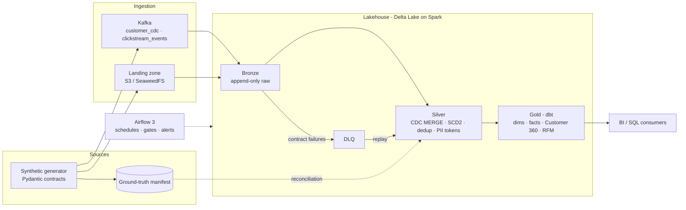

# Architecture — Multi-Tenant CRM Lakehouse Platform

> **Version**: 1.0 · 2026-11-06 · **Status**: target architecture (design intent). What is implemented and verified is tracked in [PROGRESS.md](PROGRESS.md); only verified parts may be presented as built.
> **Decisions behind it**: [PROJECT_CHARTER.md](PROJECT_CHARTER.md) §3 invariants · ADR-0007 (runtime, catalog, Gold engine) · ADR-0008/0011 (AWS: Glue 5.0, cost guardrails) · ADR-0009 (component boundaries) · ADR-0012 (Databricks track).
> **Use for diagrams**: §7 contains ready-to-use briefs for AI image tools. Every label in them matches this document.

---

## 1. One-paragraph summary

A synthetic data generator simulates several retail brands (tenants) sharing one CRM platform. Customer changes (CDC) and clickstream events flow through **Apache Kafka**; orders and the product catalogue arrive as files in an **S3-compatible landing zone**. **Spark Structured Streaming** writes everything unchanged into **Bronze** Delta tables, a validation gate sends contract failures to a **dead-letter queue (DLQ)**, and Spark builds **Silver** tables — sequence-ordered CDC current state, SCD Type 2 history, deduplicated orders and clickstream, pseudonymised PII. **dbt** builds the **Gold** marts (Kimball dimensions and facts, Customer 360, RFM segments). **Airflow** orchestrates batch runs and quality gates. The same Spark/Delta code runs locally (Docker), on **AWS Glue 5.0**, and on **Databricks** serverless; AWS is provisioned with **Terraform** and deployed through **GitHub Actions with OIDC**.

## 2. Layers and flow

| Step | Layer | Technology | What happens | Owner |
|---|---|---|---|---|
| 1 | Sources | Python generator (Faker + Pydantic contracts) | Creates customers (CDC I/U/D with `_cdc_sequence`), clickstream, orders with line items, products; injects exact, known defects; writes a ground-truth manifest | `generator` |
| 2a | Streaming transport | Apache Kafka 3.7 (KRaft) | Topics `customer_cdc`, `clickstream_events`; key `{brand_id}:{entity_id}`; `brand_id` header | — |
| 2b | Batch landing | SeaweedFS (local, S3 API) / Amazon S3 (cloud) | `landing/{brand_id}/{entity}/{date}/` files | — |
| 3 | Bronze | Spark 3.5 Structured Streaming → Delta Lake 3.3 | Append-only raw records + lineage (`_source_ref`, `_ingest_ts`, `_batch_id`); unparseable payloads kept with `_parse_error` | `ingestion` |
| 4 | Validation gate + DLQ | Spark | Contract/integrity failures → `dead_letter.dlq_*` with `_bronze_ref`; controlled replay | `quality` |
| 5 | Silver | Spark `foreachBatch` + Delta `MERGE` | CDC current state ordered by `_cdc_sequence`, tombstones, SCD2 history, dedup, composite FK checks, HMAC email tokens | `silver` |
| 6 | Gold | dbt (dbt-spark locally, dbt-databricks on Databricks) | `dim_*`, `fct_*`, `obt_customer_360`, `agg_rfm_segments`, tenant-scoped views | `dbt_project` |
| 7 | Orchestration | Apache Airflow 3 | One parametrised DAG, per-brand task mapping, quality gates, alerts; triggers Spark runs (`availableNow`) | `dags` |
| 8 | Catalog | Hive Metastore on PostgreSQL (local) · AWS Glue Data Catalog · Unity Catalog (Databricks) | Tables addressed by name | `common` config |
| 9 | Observability & ops | `ops.pipeline_metrics`, runbooks, erasure procedure | Reconciliation `bronze = silver_accepted + dlq + duplicates_removed + stale_cdc_noop + late_beyond_window` | `ops`, `quality` |

## 3. Cross-cutting guarantees (what the tests prove)

- **Tenant isolation**: `brand_id` in every key, join and MERGE condition; a negative test proves a leaky join is detected.
- **Delivery semantics**: at-least-once producer → offsets committed once per checkpoint lineage → idempotent Silver outcome. No exactly-once claim.
- **CDC correctness**: stale and out-of-order events never overwrite newer state; SCD2 history is identical for any arrival order.
- **No silent data loss**: every record is either accepted, quarantined, counted as duplicate/stale/late, or kept raw in Bronze.
- **Privacy controls**: HMAC-SHA256 tokens and masking in Silver; raw PII never reaches Gold; audited erasure procedure.

## 4. Component boundaries (microservice principles, data-platform style)

Components are independently deployable and testable and communicate **only** through versioned contracts: Kafka topics, landing paths and tables (ADR-0009). There are no synchronous calls between pipeline stages.

```
generator ──(topics, landing files, manifest)──► ingestion ──(Bronze tables)──► quality ◄── silver ──(Silver tables)──► dbt Gold
     ▲                                                                                                          ▲
     └──────────────────── contracts (event & table schemas) · common (config, logging, adapters) ─────────────┘
Airflow triggers each component through its CLI/job interface only. import-linter enforces the boundaries in CI.
```

## 5. Environments

| Concern | Local (Docker, $0) | AWS (Milestone 3) | Databricks (W6, Free Edition) |
|---|---|---|---|
| Storage | SeaweedFS (S3 API) | Amazon S3 | Unity Catalog managed storage / volume |
| Compute | Spark 3.5.9 standalone, Python 3.11 | AWS Glue 5.0 (Spark 3.5.4, Python 3.11) | Serverless jobs via Asset Bundle |
| Catalog | Hive Metastore on PostgreSQL | Glue Data Catalog (+ Athena for SQL) | Unity Catalog |
| Gold | dbt-spark → Spark Thrift Server | — (Silver queried with Athena) | dbt-databricks → SQL warehouse; AI/BI dashboard |
| Streaming | Kafka (KRaft) | not deployed (no MSK) | — |
| Provisioning | Docker Compose profiles | Terraform; GitHub Actions + OIDC; budgets | Asset Bundle + SQL grants |

## 6. Reference comparison — a typical warehouse-centric design (e.g. Zomato-style on Snowflake)

Used as a reference point, **not** as a specification for this project.

| Aspect | Reference: warehouse-centric | This platform: lakehouse with streaming |
|---|---|---|
| Flow | S3 → Snowflake RAW → dbt STAGING → dbt MARTS → serving apps | Kafka + S3-compatible landing → Spark Structured Streaming → Delta Bronze/Silver/Gold → dbt Gold |
| Storage vs. compute | One managed product: Snowflake stores **and** computes; S3 is only the file drop | Open table format (Delta) on object storage; compute is Spark (local, Glue, Databricks); S3/SeaweedFS is the storage layer itself |
| Raw layer | Tables loaded into the warehouse (e.g. `COPY INTO`) | Append-only Bronze Delta tables with lineage and raw payloads |
| Streaming | Typically batch/micro-batch loads | Kafka with keyed partitions, checkpointed Structured Streaming |
| CDC / history | Often dbt snapshots | Sequence-ordered MERGE and SCD2 owned by Spark (single history owner) |
| Multi-tenancy | Usually single-tenant analytics | Tenant key in every key/join, isolation tests |
| Data quality | dbt tests | Contracts + validation gate + DLQ/replay + reconciliation + dbt tests |
| Orchestration | Airflow | Airflow (batch, triggers `availableNow` runs) |
| AI features | Often LLM enrichment, RAG, Text-to-SQL, Streamlit apps | **Out of scope** for v1 |
| Operating model | Managed service, credit-based cost | Multi-component open-source stack; ephemeral cloud resources, budget-tracked |

Interview framing: the reference optimises for simplicity of a managed warehouse; this platform demonstrates the engineering underneath (streaming semantics, CDC ordering, idempotency, tenancy) and runs on three runtimes. Snowflake/BigQuery remain a documented skill gap (DELIVERY_PLAN §6).

## 7. Diagram briefs for AI image tools

Give the tool **one brief at a time**. Ask for: clean technical architecture diagram, white background, left-to-right flow, rounded boxes, labelled arrows, group containers, no decorative people or 3D effects, legible text.

### Brief A — End-to-end data flow (main picture)
- **Groups (left → right)**: "Sources", "Ingestion", "Lakehouse (Delta Lake)", "Analytics", with a bottom bar "Orchestration & Quality".
- **Sources**: "Synthetic generator (Python, Pydantic contracts)" with outputs "Customer CDC", "Clickstream", "Orders + items", "Products"; small side box "Ground-truth manifest".
- **Ingestion**: "Apache Kafka (topics: customer_cdc, clickstream_events)" and "Landing zone (S3 / SeaweedFS)".
- **Lakehouse**: "Bronze (raw, append-only)" → "Silver (CDC MERGE, SCD2, dedup, PII tokens)" → "Gold (dbt marts: Customer 360, RFM)"; a red box "Dead-letter queue" below Bronze with arrow "contract failures" from Bronze and arrow "replay" back to Silver.
- **Compute label** across the lakehouse group: "Apache Spark Structured Streaming".
- **Analytics**: "BI / SQL consumers" fed by Gold.
- **Bottom bar**: "Apache Airflow (schedules runs, quality gates)", "Reconciliation & metrics", "Tenant isolation tests".
- **Arrows**: generator → Kafka (CDC, clickstream); generator → Landing (orders, products); Kafka → Bronze; Landing → Bronze; Bronze → Silver; Silver → Gold; Gold → BI.

### Brief B — Three runtimes, one codebase
- Center box: "Same Python package `lakehouse` + dbt models".
- Three columns: "Local: Docker — Kafka, Spark 3.5, SeaweedFS, Hive Metastore, Airflow"; "AWS: S3, Glue 5.0 jobs, Glue Data Catalog, Athena, Terraform, GitHub Actions OIDC"; "Databricks: Unity Catalog, serverless jobs, SQL warehouse, dashboard".
- Arrows from the center to each column labelled "configuration only".

### Brief C — Component boundaries
- Five boxes in a row: "generator", "ingestion", "quality", "silver", "dbt Gold"; under them a wide box "contracts + common".
- Arrows between boxes labelled with interfaces: "Kafka topics / landing files", "Bronze tables", "validation rules", "Silver tables".
- A dashed red "X" between "generator" and "silver" with label "no direct imports (enforced by import-linter)".

### Brief D — CDC correctness (concept)
- Timeline with events for one customer: "I seq 1 (Istanbul)", "U seq 2 (Berlin)", "U seq 1 arrives late".
- Silver result box: "city = Berlin (seq 2) — late seq 1 ignored".
- SCD2 table: two rows "Istanbul valid_from…valid_to", "Berlin current".

### Mermaid source (renders on GitHub)

