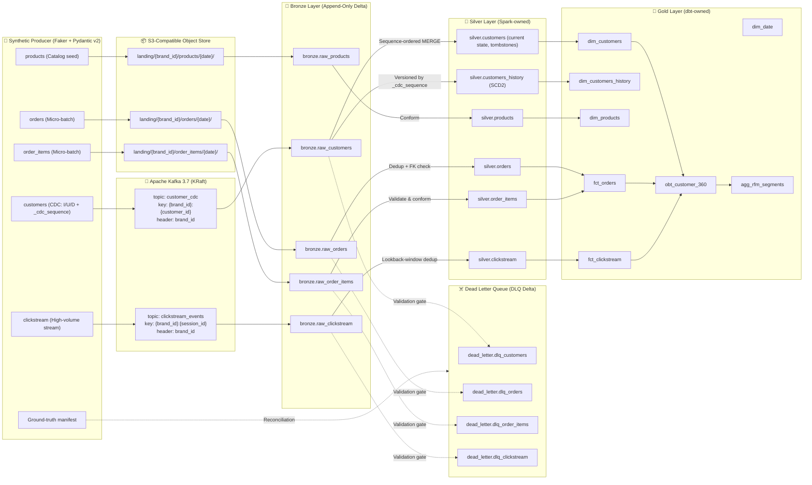

# Data Contracts & Medallion Specifications

> **Document Version**: 7.0
> **Last Updated**: 2026-11-05
> **Status**: 🟡 DRAFT — aligned with [PROJECT_CHARTER.md](PROJECT_CHARTER.md) v7. **Not yet enforced in code**; each contract becomes enforced when the corresponding PROGRESS task is ✅ with evidence.
> **Target Platform**: Multi-Tenant CRM Lakehouse (Delta Lake OSS locally; cloud targets documented separately)

> [!NOTE]
> **v7.0 changes**: composite Kafka keys + `brand_id` header; `_cdc_sequence` as the CDC ordering field (`_cdc_timestamp` → `_cdc_ts`, informational); SCD2 owned by Spark (`silver.customers_history`) instead of dbt snapshots; HMAC-SHA256 `email_token` instead of plain SHA-256; DLQ envelope references Bronze via `_bronze_ref` and carries replay metadata; landing paths and tenant counts aligned with the Charter; SLA numbers relabelled as unmeasured targets.

> [!IMPORTANT]
> All data is **fully synthetic** (Faker + Pydantic v2). The domain is inspired by the *TheLook* e-commerce model; no TheLook dataset records or real customer data are used.

---

## 1. Multi-Tenant Data Lineage



---

## 2. Ingestion Contracts & Entity Schemas

Every entity carries a mandatory, non-null tenant identifier `brand_id`, which is part of every business key and every join condition. Tenant count is configurable (demo default: 3–5 brands, e.g. `brand_alpha`, `brand_beta`, `brand_gamma`).

### 2.0 Common Kafka event envelope
Applies to `customer_cdc` and `clickstream_events` (rationale: ADR-0002, planned).

| Element | Value | Purpose |
|---|---|---|
| Message **key** | `{brand_id}:{customer_id}` (CDC) · `{brand_id}:{session_id}` (clickstream) | Determines the partition → preserves per-customer / per-session ordering and spreads tenant load |
| Header `brand_id` | tenant identifier | Routing and filtering only — **not** used for partitioning |
| Value | UTF-8 JSON of the entity schema below | Parsed into typed columns in Bronze; unparseable values stored raw with `_parse_error` |
| Producer | `enable.idempotence=true`, `acks=all` | Limits retry duplicates; delivery remains at-least-once |

### 2.1 `customers` (Streaming CDC)
- **Ingestion Mode**: Streaming via Kafka topic `customer_cdc`
- **Simulation**: CDC stream emitting `I`, `U`, `D` operations with a lifecycle-valid sequence (first event `I`, `D` terminal)
- **Bronze Target**: `bronze.raw_customers` (no physical partitioning — small table, Charter §4)
- **Business / dedup key**: `(brand_id, customer_id, _cdc_sequence)`

| Column Name | Ingestion Type | Nullable | Business Rule / Constraint | Description |
|---|---|---|---|---|
| `event_id` | STRING (UUIDv4) | No | Unique per emitted event | Event identifier |
| `customer_id` | STRING (UUID) | No | Non-empty UUID | Natural identifier, unique **within** a brand |
| `brand_id` | STRING | No | Member of the configured tenant list | Tenant identifier |
| `first_name` | STRING | No | 1–50 characters | Given name (PII) |
| `last_name` | STRING | No | 1–50 characters | Surname (PII) |
| `email` | STRING | No | RFC 5322 regex validation | Raw email (PII; tokenised in Silver, never reaches Gold) |
| `phone` | STRING | Yes | E.164 | Telephone (PII; masked to last 4 digits in Silver) |
| `city` | STRING | Yes | — | Residential city (SCD2-tracked) |
| `country` | STRING | No | ISO 3166-1 alpha-2 (e.g. `DE`, `TR`, `GB`) | Country (SCD2-tracked) |
| `loyalty_tier` | STRING | No | ENUM (`Bronze`, `Silver`, `Gold`, `Platinum`) | CRM tier (SCD2-tracked) |
| `signup_date` | DATE | No | `signup_date <= CURRENT_DATE()` | Registration date |
| `_cdc_action` | STRING | No | ENUM (`I`, `U`, `D`) | CDC operation type |
| `_cdc_sequence` | BIGINT | No | Strictly increasing per `(brand_id, customer_id)` | **Ordering field** (simulated source LSN) |
| `_cdc_ts` | TIMESTAMP | No | Source change timestamp | Informational; used only for SCD2 validity timestamps |

#### 🧪 Dirty Data Budget & Injection Spec (`customers`)
All injected defects are recorded in the ground-truth manifest, **not** in the payload.
- **Invalid Email Syntax**: 3.0% ± 0.5% (e.g. `user@`, `missing-at.com`) → DLQ
- **Null Email**: 2.0% ± 0.5% → DLQ
- **Future-Dated Signup**: 2.0% ± 0.5% → DLQ
- **Out-of-order delivery**: 5.0% ± 1.0% (sequence preserved, emission order shuffled) → handled by sequence-ordered MERGE, **not** DLQ material
- **Cross-tenant key collisions**: configured rate (same `customer_id`/email in two brands) → must remain independent states
- **Schema Drift (Batch 10+)**: new column `preferred_language: STRING` → Delta `mergeSchema` demonstration

---

### 2.2 `orders` (Transactional Micro-Batch)
- **Ingestion Mode**: Micro-batch files in landing zone `landing/{brand_id}/orders/{date}/`
- **Bronze Target**: `bronze.raw_orders` (initial partitioning: `brand_id`; finalised in ADR-0005)
- **Business / dedup key**: `(brand_id, order_id)`

| Column Name | Ingestion Type | Nullable | Business Rule / Constraint | Description |
|---|---|---|---|---|
| `order_id` | STRING (UUID) | No | Non-empty UUID | Transaction identifier |
| `brand_id` | STRING | No | Tenant identifier | Tenant context |
| `customer_id` | STRING (UUID) | No | `(brand_id, customer_id)` must exist in `silver.customers` | Foreign key (composite) |
| `order_timestamp` | TIMESTAMP | No | `order_timestamp <= CURRENT_TIMESTAMP()` | Transaction timestamp |
| `order_status` | STRING | No | ENUM (`pending`, `completed`, `cancelled`, `returned`) | Fulfilment status |
| `payment_method` | STRING | No | ENUM (`credit_card`, `paypal`, `sepa_debit`, `apple_pay`) | Payment vehicle |
| `currency` | STRING | No | ISO 4217 (`EUR`, `USD`, `TRY`) | Currency code |
| `gross_amount` | DECIMAL(10,2) | No | `gross_amount > 0` | Gross value |
| `discount_amount` | DECIMAL(10,2) | No | `discount_amount >= 0` | Promotion amount |
| `net_amount` | DECIMAL(10,2) | No | `net_amount = gross_amount - discount_amount` | Final revenue amount |

#### 🧪 Dirty Data Budget & Injection Spec (`orders`)
- **Orphan Foreign Key**: 3.0% ± 0.5% → DLQ with `_retryable = true`
- **Late-arriving parent**: configured rate (order emitted before the customer's `I`) → DLQ `_retryable = true`, recovered by controlled replay
- **Exact Duplicates**: 4.0% ± 0.5% (at-least-once replay simulation) → removed by Silver dedup and **counted**
- **Future-Dated Timestamps**: 2.0% ± 0.5% → DLQ
- **Negative Financial Value**: 1.0% ± 0.5% (`gross_amount < 0`) → DLQ

---

### 2.3 `order_items` (Order Line Items)
- **Ingestion Mode**: Micro-batch files in `landing/{brand_id}/order_items/{date}/`
- **Bronze Target**: `bronze.raw_order_items`
- **Business / dedup key**: `(brand_id, order_id, item_id)`

| Column Name | Ingestion Type | Nullable | Constraint | Description |
|---|---|---|---|---|
| `item_id` | STRING (UUID) | No | PK within order | Line item identifier |
| `order_id` | STRING (UUID) | No | FK → `(brand_id, order_id)` | Parent order |
| `brand_id` | STRING | No | Tenant identifier | Tenant context |
| `product_id` | STRING | No | FK → `(brand_id, product_id)` (same brand) | Catalog item |
| `quantity` | INTEGER | No | `quantity > 0` | Units ordered |
| `unit_price` | DECIMAL(10,2) | No | `unit_price > 0` | Price per unit |
| `line_total` | DECIMAL(10,2) | No | `line_total = quantity * unit_price` | Line amount |

---

### 2.4 `products` (Catalog Seed & Updates)
- **Ingestion Mode**: Seed / daily batch in `landing/{brand_id}/products/{date}/`
- **Bronze Target**: `bronze.raw_products`
- **Business / dedup key**: `(brand_id, product_id)`

| Column Name | Ingestion Type | Nullable | Constraint | Description |
|---|---|---|---|---|
| `product_id` | STRING | No | Format `PRD-XXXXX` | Stock keeping unit |
| `brand_id` | STRING | No | Tenant identifier | Owner brand |
| `product_name` | STRING | No | 1–255 characters | Display title |
| `category` | STRING | No | ENUM (`Apparel`, `Electronics`, `Home`, `Beauty`) | Taxonomy |
| `retail_price` | DECIMAL(10,2) | No | `retail_price > 0` | List price |
| `cost_price` | DECIMAL(10,2) | Yes | `cost_price > 0` when present | Cost of goods sold |
| `is_active` | BOOLEAN | No | Default `true` | Availability |

---

### 2.5 `clickstream_events` (High-Throughput User Interactions)
- **Ingestion Mode**: Streaming via Kafka topic `clickstream_events`
- **Bronze Target**: `bronze.raw_clickstream` (initial partitioning: `event_date`)
- **Business / dedup key**: `(brand_id, event_id)`

| Column Name | Ingestion Type | Nullable | Constraint | Description |
|---|---|---|---|---|
| `event_id` | STRING (UUIDv4) | No | Unique event token | Event identifier |
| `brand_id` | STRING | No | Tenant identifier | Tenant context |
| `session_id` | STRING (UUID) | No | Web/App session identifier | Session (Kafka key component) |
| `customer_id` | STRING (UUID) | Yes | Null for anonymous guests | Identified user |
| `event_type` | STRING | No | ENUM (`page_view`, `search`, `add_to_cart`, `checkout`, `purchase`) | Interaction type |
| `page_url` | STRING | Yes | URL path | Screen or web URL |
| `device_category` | STRING | No | ENUM (`mobile`, `desktop`, `tablet`) | Client device |
| `event_timestamp` | TIMESTAMP | No | Event occurrence time | Client event time (ordering for analytics) |

#### 🧪 Dirty Data Budget & Injection Spec (`clickstream_events`)
- **Late Arriving Records**: 10.0% ± 1.0% (timestamps 10–60 min behind) → accepted within the lookback window; beyond it **counted** as `late_beyond_window` and kept in Bronze
- **Duplicate Event Tokens**: 4.0% ± 0.5% (same `event_id` re-sent) → removed by Silver dedup and counted
- **Corrupted Session**: 1.0% ± 0.3% (null `session_id`) → DLQ
- **Malformed JSON**: configured rate → stored in Bronze with `_parse_error`

---

## 3. Bronze Metadata & Dead Letter Queue (DLQ) Envelope

### 3.1 Bronze metadata (all Bronze tables)
| Column | Description |
|---|---|
| `_ingest_ts` | Pipeline ingestion timestamp |
| `_source_ref` | Kafka `topic/partition/offset` or landing file path |
| `_batch_id` | Ingestion run / micro-batch identifier |
| `brand_id` | Tenant identifier (from payload; header/path used only as fallback for unparseable records) |
| `_raw_value` | Original payload string (stream sources) |
| `_parse_error` | Null when parsing succeeded; error text otherwise |

### 3.2 DLQ envelope
Contract and integrity failures detected at the **Bronze → Silver gate** are written to `dead_letter.dlq_*` Delta tables. The original payload **stays in Bronze**; the DLQ references it. No record is dropped silently.

```json
{
  "_dlq_id": "8f3b1e72-51a8-43d9-95a2-c128f73b64bc",
  "brand_id": "brand_alpha",
  "_source_table": "bronze.raw_orders",
  "_bronze_ref": "landing/brand_alpha/orders/2026-10-20/batch_0007.json#L42",
  "_error_category": "REFERENTIAL_INTEGRITY_VIOLATION",
  "_rejection_reason": "Foreign key (brand_alpha, 9f82d1c0-0000) not found in silver.customers",
  "_retryable": true,
  "_replay_status": "PENDING",
  "_replay_count": 0,
  "_rejected_at": "2026-10-20T02:15:30.124Z",
  "_pipeline_run_id": "bronze_to_silver_20261020_02"
}
```

| Field | Rule |
|---|---|
| `_error_category` | ENUM: `PARSE_ERROR`, `SCHEMA_VIOLATION`, `BUSINESS_RULE_VIOLATION`, `REFERENTIAL_INTEGRITY_VIOLATION`, `TIMESTAMP_OUT_OF_BOUNDS` |
| `_retryable` | `true` only when the failure can resolve later (e.g. late parent) |
| `_replay_status` | ENUM: `PENDING`, `REPLAYED`, `FAILED_AGAIN`, `DISCARDED` (discard is an audited manual action) |
| Replay | Preserves `event_id` and `_bronze_ref`; replaying the same subset twice creates no Silver duplicates |

**Reconciliation invariant (per batch)**: `input = bronze` and `bronze = silver_accepted + dlq + duplicates_removed + late_beyond_window`, checked against the generator's ground-truth manifest.

---

## 4. Silver Layer Specifications (Spark-owned)

### 4.1 CDC Reconciliation (`silver.customers`)
Processed with `foreachBatch` + Delta `MERGE` on `(brand_id, customer_id)`:
- Batch-local dedup to the highest `_cdc_sequence` per key.
- Apply only when `source._cdc_sequence > target._cdc_sequence`; lower or equal sequences are no-ops.
- `I` / `U` → upsert current attributes; `D` → tombstone (`is_deleted = true`, `email_token`, phone and other PII set to `NULL`).
- PII: `email_token = HMAC-SHA256(PII_HMAC_KEY, lower(trim(email)))`, key from env / secret store (never committed). `phone_masked` = last 4 digits. Tokens are **pseudonymous** personal data, not anonymous.

### 4.2 SCD Type 2 History (`silver.customers_history`)
Single history owner: Spark (Charter invariant 6). No dbt snapshots on customers.
- Tracked attributes: `city`, `country`, `loyalty_tier`.
- Versions ordered by `_cdc_sequence`; `valid_from` = version's `_cdc_ts`, `valid_to` = next version's `_cdc_ts` (NULL if current), `is_current`.
- `D` closes the current version. Out-of-order arrivals trigger a deterministic rebuild of the affected keys' history; the same events in any arrival order produce identical history.

### 4.3 Transactions & interactions
- `silver.orders` / `silver.order_items`: idempotent MERGE on their business keys (latest `_ingest_ts`); composite FK checks; orphans → DLQ (`_retryable = true`).
- `silver.clickstream`: in-batch dedup on `(brand_id, event_id)` + insert-only MERGE bounded by a configurable `event_date` lookback window.

---

## 5. Gold Layer Specifications (dbt-owned)

dbt reads Silver only and never writes it. No raw PII columns exist in Gold.

### 5.1 `dim_customers` / `dim_customers_history` (Kimball conformed dimensions)
- Natural key: `(brand_id, customer_id)`; surrogate key includes `brand_id`.
- Privacy columns come from Silver (`email_token`, `phone_masked`); **no hashing in dbt**.
- `dim_customers_history` exposes `silver.customers_history` (`valid_from`, `valid_to`, `is_current`).

### 5.2 `obt_customer_360` (One Big Table)
Grain: `(brand_id, customer_id)`. Denormalised for BI and feature consumption without runtime joins.

| Column Name | Type | Description / Logic |
|---|---|---|
| `customer_id` | STRING | Entity key |
| `brand_id` | STRING | Tenant key |
| `country` | STRING | Current location |
| `loyalty_tier` | STRING | Tier status |
| `tenure_days` | INTEGER | `DATEDIFF(as_of_date, signup_date)` |
| `first_order_ts` | TIMESTAMP | First order |
| `last_order_ts` | TIMESTAMP | Recency anchor |
| `recency_days` | INTEGER | `DATEDIFF(as_of_date, last_order_ts)` |
| `frequency_orders` | INTEGER | Count of completed orders |
| `monetary_total_spend` | DECIMAL(12,2) | Sum of lifetime net amounts |
| `avg_order_value` | DECIMAL(10,2) | `monetary_total_spend / frequency_orders` |
| `total_page_views` | INTEGER | Lifetime clickstream engagement |
| `total_cart_additions` | INTEGER | High-intent interactions |
| `rfm_score` | STRING | From `agg_rfm_segments` (e.g. `5-5-4`) |
| `rfm_segment` | STRING | `Champions`, `Loyal`, `At-Risk`, `Hibernating`, `Lost` |

`as_of_date` is a model variable (not `CURRENT_DATE`) so that builds are reproducible.

### 5.3 `agg_rfm_segments`
`NTILE(5)` on recency, frequency and monetary **partitioned by `brand_id`**; composite `rfm_score`; segment rules documented in the model YAML. Distributions are reported as synthetic-data results, not as real-world retail benchmarks.

### 5.4 Stretch: `agg_churn_risk_features`
Rule-based heuristic score in [0, 1] (not a trained model). Built only if Core and Extended tiers are verified.

---

## 6. Data Quality Gates & Contract Enforcement

| Layer | Contract Mechanism | Enforcement Action | Freshness Target* |
|---|---|---|---|
| **Producer** | Pydantic v2 models | Invalid generator output fails unit tests | — |
| **Landing / Kafka → Bronze** | Envelope parsing | Parse failures kept in Bronze (`_parse_error`); schema evolution via `mergeSchema` | < 5 min |
| **Bronze → Silver** | PySpark validation gate + composite anti-joins | Failures → DLQ; pipeline proceeds; reconciliation vs. manifest | < 15 min |
| **Silver → Gold** | dbt tests (`unique`, `not_null`, composite relationships, singular tests) | Test failures block downstream models; alert | Hourly |
| **Stretch** | Great Expectations suite | Distribution and drift checks without overlapping dbt tests | Post-dbt |

\* Targets only — **not measured yet**. They become claims only after measurement (Charter §8).
