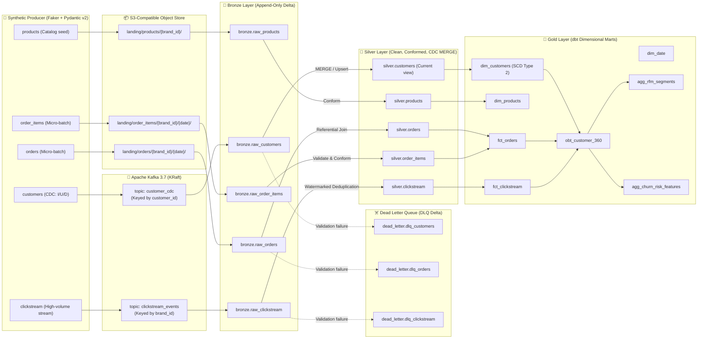

# Data Contracts & Medallion Specifications

> **Document Version**: 6.0  
> **Last Updated**: 2026-10-20  
> **Status**: 🟢 ACTIVE & ENFORCED  
> **Target Platform**: Multi-Tenant CRM Lakehouse (Delta Lake OSS / Databricks Delta)

---

## 1. Multi-Tenant Data Lineage



---

## 2. Ingestion Contracts & Entity Schemas

Every entity incorporates a mandatory tenant identifier (`brand_id`), guaranteeing multi-tenant partitioning and logical isolation.

### 2.1 `customers` (Streaming CDC)
- **Ingestion Mode**: Real-Time Streaming via Kafka topic `customer_cdc`
- **Simulation**: Change Data Capture stream emitting `INSERT`, `UPDATE`, `DELETE` operations
- **Bronze Target**: `bronze.raw_customers` (Partitioned by `brand_id`)

| Column Name | Ingestion Type | Nullable | Business Rule / Constraint | Description |
|---|---|---|---|---|
| `customer_id` | STRING (UUID) | No | Non-empty UUID | Global natural identifier |
| `brand_id` | STRING | No | ENUM (`brand_alpha`, `brand_beta`, `brand_gamma` ...) | Tenant identifier (20+ brands) |
| `first_name` | STRING | No | 1–50 characters | Customer given name |
| `last_name` | STRING | No | 1–50 characters | Customer surname |
| `email` | STRING | No | RFC 5322 regex validation | Raw email address (masked in Gold) |
| `phone` | STRING | Yes | E.164 international standard | Contact telephone |
| `city` | STRING | Yes | — | Residential city |
| `country` | STRING | No | ISO 3166-1 alpha-2 (e.g., `DE`, `TR`, `GB`) | Country of residence |
| `loyalty_tier` | STRING | No | ENUM (`Bronze`, `Silver`, `Gold`, `Platinum`) | CRM loyalty tier status |
| `signup_date` | DATE | No | `signup_date <= CURRENT_DATE()` | Registration date |
| `_cdc_action` | STRING | No | ENUM (`I`, `U`, `D`) | Ingested CDC operation type |
| `_cdc_timestamp` | TIMESTAMP | No | Event creation timestamp | Upstream transaction timestamp |

#### 🧪 Dirty Data Budget & Injection Spec (`customers`):
- **Invalid Email Syntax**: 3.0% (e.g. `user@`, `missing-at.com`) → Route to DLQ
- **Null Email**: 2.0% → Route to DLQ
- **Future-Dated Signup**: 2.0% (`signup_date > CURRENT_DATE`) → Route to DLQ
- **Schema Drift (Batch 10+)**: 100% of rows receive new column `preferred_language: STRING` → Auto Loader / Delta `mergeSchema` demonstration

---

### 2.2 `orders` (Transactional Micro-Batch)
- **Ingestion Mode**: Micro-batch arriving at S3 landing zone `landing/orders/{brand_id}/{date}/`
- **Bronze Target**: `bronze.raw_orders` (Partitioned by `brand_id`, `order_date`)

| Column Name | Ingestion Type | Nullable | Business Rule / Constraint | Description |
|---|---|---|---|---|
| `order_id` | STRING (UUID) | No | Non-empty UUID | Transaction identifier |
| `brand_id` | STRING | No | Tenant identifier | Tenant context |
| `customer_id` | STRING (UUID) | No | Must exist in `silver.customers` | Foreign key reference |
| `order_timestamp` | TIMESTAMP | No | `order_timestamp <= CURRENT_TIMESTAMP()` | Transaction timestamp |
| `order_status` | STRING | No | ENUM (`pending`, `completed`, `cancelled`, `returned`) | Fulfillment status |
| `payment_method` | STRING | No | ENUM (`credit_card`, `paypal`, `sepa_debit`, `apple_pay`) | Payment vehicle |
| `currency` | STRING | No | ISO 4217 standard (`EUR`, `USD`, `TRY`) | Currency code |
| `gross_amount` | DECIMAL(10,2) | No | `gross_amount > 0` | Gross financial value |
| `discount_amount` | DECIMAL(10,2) | No | `discount_amount >= 0` | Applied promotion amount |
| `net_amount` | DECIMAL(10,2) | No | `net_amount = gross_amount - discount_amount` | Final revenue amount |

#### 🧪 Dirty Data Budget & Injection Spec (`orders`):
- **Orphan Foreign Key**: 3.0% (`customer_id` generated with non-existent UUID) → Referential Integrity Gate → Route to DLQ
- **Exact Duplicates**: 4.0% (replay simulation of at-least-once message delivery) → Handled via Silver deduplication
- **Future-Dated Timestamps**: 2.0% → Route to DLQ
- **Negative Financial Value**: 1.0% (`gross_amount < 0`) → Business Rule Violation → Route to DLQ

---

### 2.3 `order_items` (Order Line Items)
- **Ingestion Mode**: Micro-batch arriving at S3 landing zone `landing/order_items/{brand_id}/{date}/`
- **Bronze Target**: `bronze.raw_order_items`

| Column Name | Ingestion Type | Nullable | Constraint | Description |
|---|---|---|---|---|
| `item_id` | STRING (UUID) | No | PK UUID | Line item identifier |
| `order_id` | STRING (UUID) | No | FK → `orders.order_id` | Parent order reference |
| `brand_id` | STRING | No | Tenant identifier | Tenant context |
| `product_id` | STRING | No | FK → `products.product_id` | Catalog item reference |
| `quantity` | INTEGER | No | `quantity > 0` | Units ordered |
| `unit_price` | DECIMAL(10,2) | No | `unit_price > 0` | Price per unit |
| `line_total` | DECIMAL(10,2) | No | `line_total = quantity * unit_price` | Calculated line amount |

---

### 2.4 `products` (Catalog Seed & Updates)
- **Ingestion Mode**: Daily batch seed file
- **Bronze Target**: `bronze.raw_products`

| Column Name | Ingestion Type | Nullable | Constraint | Description |
|---|---|---|---|---|
| `product_id` | STRING | No | Natural identifier (e.g. `PRD-10023`) | Stock keeping unit / ID |
| `brand_id` | STRING | No | Tenant identifier | Owner brand |
| `product_name` | STRING | No | 1–255 characters | Display title |
| `category` | STRING | No | ENUM (`Apparel`, `Electronics`, `Home`, `Beauty`) | High-level taxonomy |
| `retail_price` | DECIMAL(10,2) | No | `retail_price > 0` | Catalog list price |
| `cost_price` | DECIMAL(10,2) | Yes | `cost_price > 0` | COGS (Cost of goods sold) |
| `is_active` | BOOLEAN | No | Default `true` | Catalog availability status |

---

### 2.5 `clickstream_events` (High-Throughput User Interactions)
- **Ingestion Mode**: Real-Time Event Streaming via Kafka topic `clickstream_events`
- **Bronze Target**: `bronze.raw_clickstream` (Partitioned by `brand_id`, `event_date`)

| Column Name | Ingestion Type | Nullable | Constraint | Description |
|---|---|---|---|---|
| `event_id` | STRING (UUID) | No | Unique event token | Tracking payload identifier |
| `brand_id` | STRING | No | Tenant identifier | Brand ecosystem |
| `session_id` | STRING (UUID) | No | Web/App session identifier | Continuous user session |
| `customer_id` | STRING (UUID) | Yes | Nullable for anonymous guests | Identified user token |
| `event_type` | STRING | No | ENUM (`page_view`, `search`, `add_to_cart`, `checkout`, `purchase`) | Interaction type |
| `page_url` | STRING | Yes | Standard URL path | Screen or web URL |
| `device_category` | STRING | No | ENUM (`mobile`, `desktop`, `tablet`) | Client device type |
| `event_timestamp` | TIMESTAMP | No | Event occurrence timestamp | Client event time |

#### 🧪 Dirty Data Budget & Injection Spec (`clickstream_events`):
- **Late Arriving Records**: 10.0% (timestamps 10 to 60 minutes behind pipeline watermark)
- **Duplicate Event Tokens**: 4.0% (at-least-once replay simulation)
- **Corrupted Session**: 1.0% (null session token) → Route to DLQ

---

## 3. Dead Letter Queue (DLQ) Envelope Specification

When any data quality test or schema contract is breached in Bronze, the raw payload is quarantined into `dead_letter.dlq_*` Delta tables. **No records are permanently dropped.**

```json
{
  "_dlq_id": "8f3b1e72-51a8-43d9-95a2-c128f73b64bc",
  "_brand_id": "brand_alpha",
  "_source_table": "bronze.raw_orders",
  "_error_category": "REFERENTIAL_INTEGRITY_VIOLATION",
  "_rejection_reason": "Foreign key customer_id 9f82d1c0-0000 does not exist in silver.customers",
  "_rejected_at": "2026-10-20T02:15:30.124Z",
  "_pipeline_run_id": "airflow_dag_run_20261020_02",
  "_original_payload": "{\"order_id\": \"d739b...\", \"customer_id\": \"9f82d1c0-0000\", \"gross_amount\": 149.99}"
}
```

---

## 4. Silver Layer Specifications (Curated & Historical)

### 4.1 CDC Reconciliation (`silver.customers`)
In Silver, customer updates are processed using Delta Lake `MERGE INTO`:
- Action `I` (Insert): Inserts new customer record.
- Action `U` (Update): Overwrites current profile attributes.
- Action `D` (Delete): Performs GDPR soft-deletion (`is_deleted = true`, email scrubbed).

### 4.2 Slowly Changing Dimensions (SCD Type 2 via dbt Snapshots)
To preserve historical changes (e.g., when a customer relocates from Istanbul to Berlin or changes loyalty tiers), a dbt snapshot builds historical dimension tracking:
- `dbt_valid_from`: Timestamp of attribute validity commencement.
- `dbt_valid_to`: Timestamp of expiration (`NULL` for current row).
- `dbt_is_current`: Boolean indicating active record.

---

## 5. Gold Layer Specifications (Business Marts & ML Features)

### 5.1 `dim_customers` (Kimball Conformed Dimension)
- Natural Key: `customer_id`, `brand_id`
- **GDPR Privacy Compliance**: `email_hash` (`SHA256(email)`), phone masked to last 4 digits.
- Features: `tenure_days`, `total_lifetime_orders`, `total_lifetime_spend`.

### 5.2 `obt_customer_360` (One Big Table)
Denormalized, high-performance table optimized for analytical BI tools (Metabase, Power BI) and ML feature ingestion without multi-table joins.

| Column Name | Type | Description / Logic |
|---|---|---|
| `customer_id` | STRING | Primary entity key |
| `brand_id` | STRING | Tenant key |
| `country` | STRING | Current location |
| `loyalty_tier` | STRING | Tier status |
| `first_order_ts` | TIMESTAMP | Customer acquisition transaction |
| `last_order_ts` | TIMESTAMP | Recency anchor |
| `recency_days` | INTEGER | `DATEDIFF(CURRENT_DATE, last_order_ts)` |
| `frequency_orders` | INTEGER | Count of completed orders |
| `monetary_total_spend` | DECIMAL(12,2) | Sum of lifetime net order amounts |
| `avg_order_value` | DECIMAL(10,2) | `monetary_total_spend / frequency_orders` |
| `total_page_views` | INTEGER | Lifetime clickstream engagement |
| `total_cart_additions` | INTEGER | High-intent interaction frequency |
| `rfm_score` | STRING | Quantile calculation (e.g., `5-5-4`) |
| `rfm_segment` | STRING | Segmentation (`Champions`, `Loyal`, `At-Risk`, `Lost`) |
| `churn_risk_score` | DECIMAL(4,3) | Normalized risk metric (0.000 to 1.000) |
| `churn_risk_category` | STRING | `LOW`, `MEDIUM`, `HIGH_RISK` |

---

## 6. Data Quality SLA & Contract Enforcement

| Layer | Contract Mechanism | Enforcement Action | SLA Target |
|---|---|---|---|
| **Landing → Bronze** | Pydantic v2 & Schema Validation | Schema evolution permitted; type corruptions logged | < 5 min lag |
| **Bronze → Silver** | PySpark Assertions & Anti-Joins | Corrupt records quarantined to DLQ; pipeline proceeds | < 15 min lag |
| **Silver → Gold** | dbt Core YAML Tests (`unique`, `not_null`, `relationships`) | Test failures block Gold downstream views; alert triggered | Hourly refresh |
| **Gold Governance** | Great Expectations Suite | Verifies aggregate drift, distribution bounds, null ratios | Post-dbt execution |