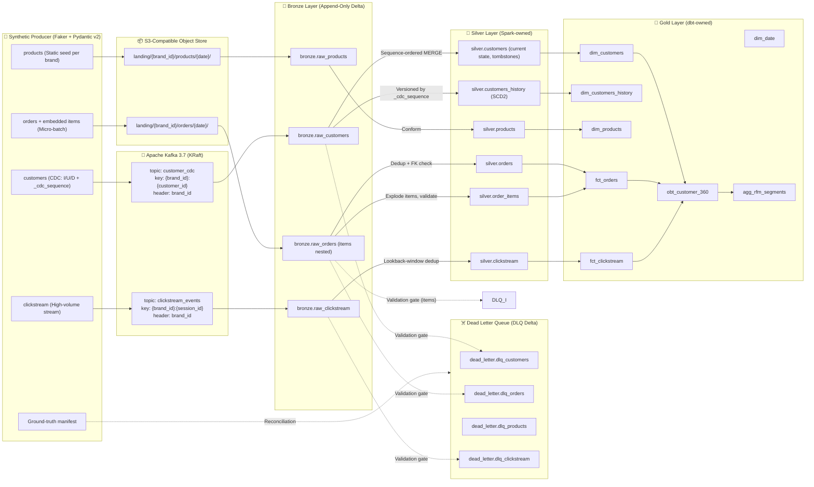

# Data Contracts & Medallion Specifications

> **Document Version**: 8.0
> **Last Updated**: 2026-11-11 (v8.0: orders/products gate rules, insert-only orders with first-copy-wins, FK orphans and replay, clickstream lookback window, no items DLQ, D-077..D-080; v7.9: reconciliation term definitions — `bronze` = distinct parseable `_source_ref`, `reread_rows`/`parse_errors` reported beside the equation, CDC `late_beyond_window` = 0 by design, D-072; v7.8: landing → Bronze as built — `sales_channel` via contract schema, `mergeSchema` only on the Bronze write of landing files, D-071; v7.7: non-UTF-8 Kafka key → `brand_key_mismatch`, D-068; v7.6: gate transport rules `kafka_key_missing` / `brand_header_missing`, `rejected_duplicates` vs `duplicates_removed` glossary, Q-002/Q-004; v7.5: DLQ envelope §3.2 as built — `_rejection_codes`, `event_id`, Kafka `_bronze_ref`, `PARSE_ERROR` reserved, D-062; v7.4: Bronze metadata columns as built §3.1, stable `_parse_error` codes, headers persisted, no `mergeSchema` on Bronze, D-047; v7.3: CDC ground-truth manifest §2.1.1, gate order and outcome precedence §4.1; v7.2: `event_id`/`schema_version`/`produced_at` payload fields, duplicate CDC defect, producer/consumer unknown-field rule, 2-decimal money strings; v7.1: orders carry embedded line items; static product seed; `schema_version` in the envelope; schema-evolution demo moved to orders; reconciliation adds `stale_cdc_noop` — DELIVERY_PLAN v8, ADR-0009)
> **Status**: 🟡 DRAFT — aligned with [PROJECT_CHARTER.md](PROJECT_CHARTER.md) v7. **Not yet enforced in code**; each contract becomes enforced when the corresponding PROGRESS task is ✅ with evidence.
> **Target Platform**: Multi-Tenant CRM Lakehouse (Delta Lake OSS locally; cloud targets documented separately)

> [!NOTE]
> **v7.0 changes**: composite Kafka keys + `brand_id` header; `_cdc_sequence` as the CDC ordering field (`_cdc_timestamp` → `_cdc_ts`, informational); SCD2 owned by Spark (`silver.customers_history`) instead of dbt snapshots; HMAC-SHA256 `email_token` instead of plain SHA-256; DLQ envelope references Bronze via `_bronze_ref` and carries replay metadata; landing paths and tenant counts aligned with the Charter; SLA numbers relabelled as unmeasured targets.

> [!IMPORTANT]
> All data is **fully synthetic** (Faker + Pydantic v2). The domain is inspired by the *TheLook* e-commerce model; no TheLook dataset records or real customer data are used.

---

## 1. Multi-Tenant Data Lineage



---

## 2. Ingestion Contracts & Entity Schemas

Every entity carries a mandatory, non-null tenant identifier `brand_id`, which is part of every business key and every join condition. Tenant count is configurable (demo default: 3–5 brands, e.g. `brand_alpha`, `brand_beta`, `brand_gamma`).

Rates are acceptance bands; the generator injects `round_half_even(n × rate)` defects exactly and records them in the manifest.

### 2.0 Common Kafka event envelope
Applies to `customer_cdc` and `clickstream_events` (rationale: [ADR-0002](adr/0002-event-interface-kafka-envelope.md)).

| Element | Value | Purpose |
|---|---|---|
| Message **key** | `{brand_id}:{customer_id}` (CDC) · `{brand_id}:{session_id}` (clickstream) | Determines the partition → preserves per-customer / per-session ordering and spreads tenant load |
| Header `brand_id` | tenant identifier | Routing and filtering only — **not** used for partitioning |
| Value | UTF-8 JSON of the entity schema below | Parsed into typed columns in Bronze; unparseable values stored raw with `_parse_error` |
| Header `schema_version` / `event_type` | e.g. `1` / `page_view` (CDC: `customer_cdc`) | Routing copies. Bronze keeps them in `_kafka_headers` for lineage only; the payload field `schema_version` stays authoritative (D-047). Additive changes keep the version, breaking changes bump it (ADR-0009) |
| Payload `event_id`, `schema_version`, `produced_at` | UUIDv4 · integer `1` · UTC timestamp | Present on CDC and clickstream events; `produced_at` is the producer's emission time |
| Null `session_id` (clickstream) | key `{brand_id}:` | Such events land in Bronze and are rejected to the DLQ downstream |
| Money (orders, items, products) | JSON string with exactly 2 decimals, e.g. `"12.50"` | Avoids binary-float rounding; parsed into `DECIMAL(10,2)` |
| Unknown fields | producers reject, consumers ignore (within one `schema_version`) | This is what makes additive changes non-breaking |
| Producer | `enable.idempotence=true`, `acks=all` (settings: D-036) | Limits retry duplicates; delivery remains at-least-once |

Identifiers (`event_id`, `customer_id`, `session_id`, `order_id`, `item_id`) are lowercase UUIDv4 strings. The key/header helpers in `lakehouse.contracts` do not validate the content of `brand_id`, because injected-defect payloads bypass the models; they only refuse a missing or empty `brand_id`. The `brand_id` format is enforced by the contract gate.

### 2.1 `customers` (Streaming CDC)
- **Ingestion Mode**: Streaming via Kafka topic `customer_cdc`
- **Simulation**: CDC stream emitting `I`, `U`, `D` operations with a lifecycle-valid sequence (first event `I`, `D` terminal)
- **Bronze Target**: `bronze.raw_customers` (no physical partitioning — small table, Charter §4)
- **Business / dedup key**: `(brand_id, customer_id, _cdc_sequence)`

| Column Name | Ingestion Type | Nullable | Business Rule / Constraint | Description |
|---|---|---|---|---|
| `event_id` | STRING (UUIDv4) | No | Unique per emitted event | Event identifier |
| `customer_id` | STRING (UUIDv4) | No | Lowercase UUIDv4 | Natural identifier, unique **within** a brand |
| `brand_id` | STRING | No | Member of the configured tenant list, pattern `brand_[a-z0-9_]+` | Tenant identifier |
| `schema_version` | INTEGER | No | `1` | Contract version (authoritative copy, §2.0) |
| `produced_at` | TIMESTAMP | No | UTC, timezone-aware | Producer emission time |
| `first_name` | STRING | No | 1–50 characters | Given name (PII) |
| `last_name` | STRING | No | 1–50 characters | Surname (PII) |
| `email` | STRING | No | RFC 5322 regex validation | Raw email (PII; tokenised in Silver, never reaches Gold) |
| `phone` | STRING | Yes | E.164 | Telephone (PII; masked to last 4 digits in Silver) |
| `city` | STRING | Yes | — | Residential city (SCD2-tracked) |
| `country` | STRING | No | ISO 3166-1 alpha-2 shape `[A-Z]{2}` (e.g. `DE`, `TR`, `GB`) | Country (SCD2-tracked) |
| `loyalty_tier` | STRING | No | ENUM (`Bronze`, `Silver`, `Gold`, `Platinum`) | CRM tier (SCD2-tracked) |
| `signup_date` | DATE | No | `signup_date <= produced_at` (date part) | Registration date |
| `_cdc_action` | STRING | No | ENUM (`I`, `U`, `D`) | CDC operation type |
| `_cdc_sequence` | BIGINT | No | Strictly increasing per `(brand_id, customer_id)` | **Ordering field** (simulated source LSN) |
| `_cdc_ts` | TIMESTAMP | No | Source change timestamp | Informational; used only for SCD2 validity timestamps |

#### 🧪 Dirty Data Budget & Injection Spec (`customers`)
All injected defects are recorded in the ground-truth manifest, **not** in the payload.
- **Invalid Email Syntax**: 3.0% ± 0.5% (e.g. `user@`, `missing-at.com`) → DLQ
- **Null Email**: 2.0% ± 0.5% → DLQ
- **Future-Dated Signup**: 2.0% ± 0.5% → DLQ
- **Out-of-order delivery**: 5.0% ± 1.0% (sequence preserved, emission order shuffled) → handled by sequence-ordered MERGE, **not** DLQ material
- **Duplicate CDC events**: 2.0% ± 0.5% (exact replay, same `event_id`) → counted as duplicates
- **Cross-tenant key collisions**: 1.0% default (same `customer_id`/email in two brands) → must remain independent states

---

### 2.2 `orders` (Transactional Micro-Batch)
- **Ingestion Mode**: Micro-batch files in landing zone `landing/{brand_id}/orders/{date}/`
- **Bronze Target**: `bronze.raw_orders` (initial partitioning: `brand_id`; finalised in ADR-0005)
- **Business / dedup key**: `(brand_id, order_id)`

| Column Name | Ingestion Type | Nullable | Business Rule / Constraint | Description |
|---|---|---|---|---|
| `schema_version` | INTEGER | No | `1` | Contract version |
| `order_id` | STRING (UUIDv4) | No | Lowercase UUIDv4 | Transaction identifier |
| `brand_id` | STRING | No | Tenant identifier | Tenant context |
| `customer_id` | STRING (UUIDv4) | No | `(brand_id, customer_id)` must exist in `silver.customers` | Foreign key (composite) |
| `order_timestamp` | TIMESTAMP | No | `order_timestamp <= _ingest_ts` (deterministic on re-runs, D-077) | Transaction timestamp |
| `order_status` | STRING | No | ENUM (`pending`, `completed`, `cancelled`, `returned`) | Fulfilment status |
| `payment_method` | STRING | No | ENUM (`credit_card`, `paypal`, `sepa_debit`, `apple_pay`) | Payment vehicle |
| `currency` | STRING | No | ISO 4217 (`EUR`, `USD`, `TRY`) | Currency code |
| `gross_amount` | DECIMAL(10,2) | No | `gross_amount > 0` | Gross value |
| `discount_amount` | DECIMAL(10,2) | No | `discount_amount >= 0` | Promotion amount |
| `net_amount` | DECIMAL(10,2) | No | `net_amount = gross_amount - discount_amount` | Final revenue amount |
| `items` | ARRAY<STRUCT> | No | 1–5 line items, schema in §2.3 | Embedded line items (exploded into `silver.order_items`) |
| `sales_channel` | STRING | Yes | ENUM (`web`, `app`, `store`); present from landing batch 10 onwards | **Schema evolution demo** (additive producer change: the key is absent before batch 10). Bronze projects the contract schema, so the column exists from batch 1 and is NULL before batch 10; Delta `mergeSchema` on the Bronze write of landing files lets a later contract version add a column to the existing table (D-071) |

#### 🧪 Dirty Data Budget & Injection Spec (`orders`)
- **Orphan Foreign Key**: 3.0% ± 0.5% → DLQ with `_retryable = true`
- **Late-arriving parent**: 2.0% default (order emitted before the customer's `I`) → DLQ `_retryable = true`, recovered by controlled replay
- **Exact Duplicates**: 4.0% ± 0.5% (at-least-once replay simulation) → removed by Silver dedup and **counted**
- **Future-Dated Timestamps**: 2.0% ± 0.5% → DLQ
- **Negative Financial Value**: 1.0% ± 0.5% (`gross_amount < 0`) → DLQ

---

### 2.3 `order_items` (Order Line Items)
- **Ingestion Mode**: embedded in `orders.items` (no separate landing entity); exploded at the Bronze → Silver gate
- **Silver Target**: `silver.order_items`; item failures are rejected with their order line into `dead_letter.dlq_orders` (no separate items DLQ, D-077)
- **Business / dedup key**: `(brand_id, order_id, item_id)`

| Column Name | Ingestion Type | Nullable | Constraint | Description |
|---|---|---|---|---|
| `item_id` | STRING (UUIDv4) | No | PK within order | Line item identifier |
| `order_id` | STRING (UUIDv4) | No | FK → `(brand_id, order_id)` | Parent order |
| `brand_id` | STRING | No | Tenant identifier | Tenant context |
| `product_id` | STRING | No | FK → `(brand_id, product_id)` (same brand) | Catalog item |
| `quantity` | INTEGER | No | `quantity > 0` | Units ordered |
| `unit_price` | DECIMAL(10,2) | No | `unit_price > 0` | Price per unit |
| `line_total` | DECIMAL(10,2) | No | `line_total = quantity * unit_price` | Line amount |

---

### 2.4 `products` (Catalog Seed)
- **Ingestion Mode**: static seed per brand, landed once in `landing/{brand_id}/products/{date}/` (no dirty-data injection)
- **Bronze Target**: `bronze.raw_products`
- **Business / dedup key**: `(brand_id, product_id)`

| Column Name | Ingestion Type | Nullable | Constraint | Description |
|---|---|---|---|---|
| `schema_version` | INTEGER | No | `1` | Contract version |
| `product_id` | STRING | No | Format `PRD-XXXXX` | Stock keeping unit |
| `brand_id` | STRING | No | Tenant identifier | Owner brand |
| `product_name` | STRING | No | 1–255 characters | Display title |
| `category` | STRING | No | ENUM (`Apparel`, `Electronics`, `Home`, `Beauty`) | Taxonomy |
| `retail_price` | DECIMAL(10,2) | No | `retail_price > 0` | List price |
| `cost_price` | DECIMAL(10,2) | Yes | `cost_price > 0` when present | Cost of goods sold |
| `is_active` | BOOLEAN | No | Default `true` | Availability |

---

### 2.5 `clickstream_events` (High-Throughput User Interactions)
- **Ingestion Mode**: Streaming via Kafka topic `clickstream_events`
- **Bronze Target**: `bronze.raw_clickstream` (initial partitioning: `event_date`)
- **Business / dedup key**: `(brand_id, event_id)`

| Column Name | Ingestion Type | Nullable | Constraint | Description |
|---|---|---|---|---|
| `event_id` | STRING (UUIDv4) | No | Unique event token | Event identifier |
| `brand_id` | STRING | No | Tenant identifier | Tenant context |
| `schema_version` | INTEGER | No | `1` | Contract version (authoritative copy, §2.0) |
| `produced_at` | TIMESTAMP | No | UTC, timezone-aware | Producer emission time |
| `session_id` | STRING (UUIDv4) | No | Web/App session identifier | Session (Kafka key component) |
| `customer_id` | STRING (UUIDv4) | Yes | Null for anonymous guests | Identified user |
| `event_type` | STRING | No | ENUM (`page_view`, `search`, `add_to_cart`, `checkout`, `purchase`) | Interaction type |
| `page_url` | STRING | Yes | URL path | Screen or web URL |
| `device_category` | STRING | No | ENUM (`mobile`, `desktop`, `tablet`) | Client device |
| `event_timestamp` | TIMESTAMP | No | Event occurrence time | Client event time (ordering for analytics) |

#### 🧪 Dirty Data Budget & Injection Spec (`clickstream_events`)
- **Late Arriving Records**: 10.0% ± 1.0% (timestamps 10–60 min behind) → accepted within the lookback window; beyond it **counted** as `late_beyond_window` and kept in Bronze
- **Duplicate Event Tokens**: 4.0% ± 0.5% (same `event_id` re-sent) → removed by Silver dedup and counted
- **Corrupted Session**: 1.0% ± 0.3% (null `session_id`) → DLQ
- **Malformed JSON**: 0.5% default → stored in Bronze with `_parse_error`

#### 2.5.1 Ground-truth manifest (`clickstream_manifest.json`)
- `counts`: `base`, `late`, `duplicate`, `null_session`, `malformed_json`, `emitted` (= `base + duplicate`); every defect count is `round_half_even(base × rate)` exactly. Defects are disjoint; duplicates are byte-identical copies of clean events.
- `entries` (defective messages only, sorted by `index`): `index` (emission order, **not** a Kafka offset), `event_id`, `brand_id`, `defect`, `expected_outcome` — `late → ACCEPT`, `duplicate → DUPLICATE`, `null_session → DLQ`, `malformed_json → PARSE_ERROR`.
- `PARSE_ERROR` events stay in Bronze only (raw value + `_parse_error`); they are neither DLQ nor Silver. Their manifest `event_id` is the original one (D-035), which Silver cannot read, so they are reconciled by count per `brand_id`, not by `event_id`.

#### 2.1.1 Ground-truth manifest (`cdc_manifest.json`)
Written next to `cdc_events.ndjson` by `python -m lakehouse.generator cdc`; it is the test oracle for Silver.
Same seed and config give byte-identical files (verified with the pinned Faker version on Python 3.11; other Faker or Python versions may differ).
- Header: `seed`, `brands` (tenant count), `base_events` (= `--events`, clean lifecycle events), `emitted_events` (base + replays),
  `generator_version`, `config_fingerprint` (sha256 of the generation-relevant settings only).
- `entries`: one per **emission** in emission order (a replay shares `event_id` with its original): `emission_index`, `event_id`,
  `brand_id`, `customer_id`, `cdc_sequence`, `cdc_action`, `defect` (null for clean events), `expected_outcome`
  (`ACCEPT`, `DLQ`, `DUPLICATE`, `NOOP`, computed with batch size 1, see §4.1). The `cross_tenant_collision` tag sits only on the colliding
  customer's `I` entry in brand B.
- `expected_final`: per `(brand_id, customer_id)` the valid emission with the highest sequence (`cdc_sequence`, `event_id`, `cdc_action`,
  `is_deleted`, `city`, `country`, `loyalty_tier`). A customer whose events are all in the DLQ has no row.
- `counts`: per defect (`invalid_email`, `null_email`, `future_signup`, `out_of_order`, `duplicate`, `cross_tenant_collision`) and the
  reconciliation terms:

| Outcome | Reconciliation term |
|---|---|
| `ACCEPT` | `silver_accepted` |
| `DLQ` | `dlq` |
| `DUPLICATE` | `duplicates_removed` |
| `NOOP` | `stale_cdc_noop` |
| (none in the CDC stream) | `late_beyond_window` = 0 |

`bronze == emitted` (CDC has no parse errors) and `emitted == silver_accepted + dlq + duplicates_removed + stale_cdc_noop + late_beyond_window`.

Injection units: event-level rates apply to the `--events` base events; `cdc_delete_rate` to customers per tenant (exactly
`round_half_even(customers × rate)` customers end with `D`); `cross_tenant_collision` to customers of brands 2..N. Each emission carries at
most one defect. If a defect pool is too small the generator fails with `InfeasibleDefectPlan` instead of injecting fewer defects.

---

## 3. Bronze Metadata & Dead Letter Queue (DLQ) Envelope

### 3.1 Bronze metadata (all Bronze tables)
| Column | Description |
|---|---|
| `_ingest_ts` | Pipeline ingestion timestamp |
| `_source_ref` | Kafka `topic/partition/offset` or landing file path |
| `_batch_id` | Ingestion run / micro-batch identifier. Stream sources: `<streaming query id>:<micro-batch id>`, unique per checkpoint lineage |
| `brand_id` | Tenant identifier (from payload; header/path used only as fallback for unparseable records). A parseable record without a payload `brand_id` keeps NULL and is rejected by the gate. NULL is also possible for an unparseable record without a header; the row is kept |
| `_raw_value` | Original payload string (stream sources). Base64 of the bytes when `_parse_error = invalid_utf8`; NULL for a Kafka tombstone |
| `_parse_error` | Null when parsing succeeded; otherwise a stable code, in precedence order: `null_value`, `invalid_utf8`, `malformed_json`. On any code all parsed contract fields are NULL |
| `_kafka_key` | Stream sources: message key, binary, unchanged |
| `_kafka_headers` | Stream sources: `ARRAY<STRUCT<key STRING, value BINARY>>`, unchanged. Lineage only (D-047) |
| `_kafka_ts` | Stream sources: Kafka record timestamp |
| `event_date` | `bronze.raw_clickstream` partition column: UTC date of `event_timestamp`, else of `_kafka_ts` when missing or unparseable, so a reload lands in the same partition |

Known limit (measured, Spark 3.5.9): `from_json` accepts trailing garbage after the first JSON object, so `{"a":"1"} xyz` is parsed and not flagged; `_raw_value` retains the full text.

### 3.2 DLQ envelope
Contract and integrity failures detected at the **Bronze → Silver gate** are written to `dead_letter.dlq_*` Delta tables. The original payload **stays in Bronze**; the DLQ references it. No record is dropped silently.

```json
{
  "_dlq_id": "<sha256 of coalesce(brand_id,'') | _source_table | _source_ref>",
  "brand_id": "brand_alpha",
  "_source_table": "bronze.raw_customers",
  "_bronze_ref": "customer_cdc/2/1187",
  "event_id": "5b0f3c1e-8d2a-4f61-9c4e-2a7d9e1b6f30",
  "_error_category": "SCHEMA_VIOLATION",
  "_rejection_reason": "email_invalid",
  "_rejection_codes": ["email_invalid"],
  "_retryable": false,
  "_replay_status": "PENDING",
  "_replay_count": 0,
  "_rejected_at": "2026-11-10T18:31:02.114Z",
  "_pipeline_run_id": "dlq_gate_20261110T183050Z_1a2b3c4d"
}
```
As built in M1 (D-057, D-062): stream entities only; `_bronze_ref` = the Bronze `_source_ref`
(`topic/partition/offset`); a landing-file reference (`landing/...#L<n>`) applies to file-based
entities from M2. `_rejection_codes` lists every failing rule code (stable codes, D-056);
`_rejection_reason` joins them with `", "`. One Kafka message maps to one `_dlq_id`.

| Field | Rule |
|---|---|
| `_error_category` | ENUM: `PARSE_ERROR`, `SCHEMA_VIOLATION`, `BUSINESS_RULE_VIOLATION`, `REFERENTIAL_INTEGRITY_VIOLATION`, `TIMESTAMP_OUT_OF_BOUNDS`. `PARSE_ERROR` is reserved and not written: parse failures stay in Bronze with `_parse_error` (§3.1, D-056) |
| `_rejection_codes` | `ARRAY<STRING>`, non-empty: every failing rule code of `lakehouse.quality.rules`, in rule order; `_error_category` and `_retryable` follow the first hit and any hit respectively |
| `event_id` | Payload `event_id` as a string (may be NULL or invalid for a rejected row; masked in reports) |
| `_retryable` | `true` only when the failure can resolve later (e.g. late parent) |
| `_replay_status` | ENUM: `PENDING`, `REPLAYED`, `FAILED_AGAIN`, `DISCARDED` (discard is an audited manual action) |
| Transport rules (Q-002) | Part of the envelope rules in `lakehouse.quality.rules`, `SCHEMA_VIOLATION`, `_retryable = false`, applied to both stream tables and to parsed rows only (rows with `_parse_error` stay in Bronze). `kafka_key_missing`: `_kafka_key` is NULL or empty. `brand_header_missing`: no `brand_id` header in `_kafka_headers`, or its value is NULL. `brand_key_mismatch` / `brand_header_mismatch` fire only when the key / header is present; a present key that is not valid UTF-8 counts as `brand_key_mismatch` (D-068). These are Kafka-transport checks with no Pydantic counterpart. |
| Replay | Preserves `event_id` and `_bronze_ref`; replaying the same subset twice creates no Silver duplicates |

**Reconciliation invariant (per batch, counted in events)**: `input = bronze` and `bronze = silver_accepted + dlq + duplicates_removed + stale_cdc_noop + late_beyond_window`, checked against the generator's ground-truth manifest. `stale_cdc_noop` counts CDC events whose `_cdc_sequence` is not newer than the Silver state. All terms are written to `ops.pipeline_metrics`.

**Term definitions (D-072)**: `bronze` counts events, i.e. distinct `_source_ref` rows with `_parse_error IS NULL`; a Bronze row that re-reads an already stored `_source_ref` (D-057) is counted as `reread_rows`, and unparseable rows as `parse_errors` — both reported next to the equation, never inside it. For CDC `late_beyond_window` is 0 by design: the sequence-guarded MERGE has no watermark, so a late event is applied or becomes `stale_cdc_noop`. Silver table names: `silver.customers`, `silver.customers_history`.

**Duplicate terms (do not mix them)**: `rejected_duplicates` (extra copies of an already rejected `_dlq_id` inside one gate run) and `bronze_duplicate_rows` (`rows_read - distinct _source_ref`, i.e. a re-read of the same Kafka offsets) are M1 gate counters and are not reconciliation terms; `duplicates_removed` is the manifest/reconciliation term for duplicate CDC events removed by Silver dedup (M2).

**Injection is exact, not probabilistic**: the generator selects exactly `round(n × rate)` records per defect type with a seeded RNG, so tests assert exact counts against the manifest; the ± tolerances above describe the configured rate only.

---

## 4. Silver Layer Specifications (Spark-owned)

### 4.1 CDC Reconciliation (`silver.customers`)
**Gate order** (the Silver job and the manifest oracle follow it): contract gate (DLQ) → dedup → sequence-ordered MERGE.

**Outcome precedence per emission**, evaluated in emission order (the manifest's `expected_outcome` is this rule with batch size 1):
1. payload fails the `customer_cdc` contract → `DLQ`;
2. key `(brand_id, customer_id, _cdc_sequence)` already seen in an earlier **valid** emission → `DUPLICATE`. The check runs against **all
   earlier valid emissions in Bronze** (DLQ rows excluded), not only within the current batch and not against Silver —
   an earlier event that ended as `NOOP` never reaches Silver, but its replay is still a `DUPLICATE`;
3. `_cdc_sequence` ≤ highest valid sequence already applied for `(brand_id, customer_id)` → `NOOP` (stale);
4. otherwise → `ACCEPT`.

With micro-batches, only the highest-sequence valid non-duplicate event per key in a batch can be `ACCEPT` (batch-local dedup); the rest of the
batch for that key is `NOOP`. A DLQ'd `I` is not a referential-integrity failure: a later valid `U` carries the full row image and is
`ACCEPT`ed into an empty target.

Processed with `foreachBatch` + Delta `MERGE` on `(brand_id, customer_id)`:
- Batch-local dedup to the highest `_cdc_sequence` per key.
- Apply only when `source._cdc_sequence > target._cdc_sequence`; lower or equal sequences are no-ops.
- `I` / `U` → upsert current attributes; `D` → tombstone (`is_deleted = true`, `email_token`, phone and other PII set to `NULL`).
- PII: `email_token = HMAC-SHA256(PII_HMAC_KEY, lower(trim(email)))`, key from env / secret store (never committed). `phone_masked` = last 4 digits. Tokens are **pseudonymous** personal data, not anonymous.

### 4.2 SCD Type 2 History (`silver.customers_history`)
Single history owner: Spark (Charter invariant 6). No dbt snapshots on customers.
- Tracked attributes: `city`, `country`, `loyalty_tier`.
- Versions ordered by `_cdc_sequence`; `valid_from` = version's `_cdc_ts`, `valid_to` = next version's `_cdc_ts` (NULL if current), `is_current`.
- `D` closes the current version. Out-of-order arrivals trigger a deterministic rebuild of the affected keys' history; the same events in any arrival order produce identical history.

### 4.3 Transactions & interactions
- `silver.products`: latest valid Bronze copy per `(brand_id, product_id)` (ranked by `_ingest_ts`, landing file, line number; parse errors and `product.v1` rule failures excluded), MERGE insert / update when `_bronze_ref` changes, no deletes (D-094).
- `silver.orders` / `silver.order_items`: insert-only MERGE on `(brand_id, order_id)` / `(brand_id, order_id, item_id)`; the first valid Bronze copy wins and later copies (also of an order already in Silver) are counted `duplicates_removed`; composite FK checks against `silver.customers` (a tombstone counts as present) and valid Bronze products of the same brand; orphans → `dead_letter.dlq_orders` with `_retryable = true` (`customer_fk_missing` / `product_fk_missing`, `REFERENTIAL_INTEGRITY_VIOLATION`). A late parent is indistinguishable from an orphan at run time and is recovered by the `replay` job: `PENDING`/`FAILED_AGAIN` rows below `--max-replays` are re-checked, recovered rows inserted into Silver before their DLQ row becomes `REPLAYED` (`_replay_count + 1`). In the reconciliation `dlq` term, `REPLAYED` rows count as `silver_accepted` (D-078, D-080).
- `silver.clickstream`: in-batch dedup on `(brand_id, event_id)` (lowest Kafka partition/offset wins) + insert-only MERGE on `(brand_id, event_id, event_date)`: an event is `late_beyond_window` when `produced_at − event_timestamp > lookback_days` (default 7, both payload fields on the simulated clock), so outcomes do not depend on batching or on other events (D-086). Generated late events are minutes late, so `late_beyond_window` is 0 on generated data (D-079).

---

## 5. Gold Layer Specifications (dbt-owned)

dbt reads Silver only and never writes it. No raw PII columns exist in Gold.

### 5.1 `dim_customers` / `dim_customers_history` (Kimball conformed dimensions)
- Natural key: `(brand_id, customer_id)`; surrogate key includes `brand_id`.
- Privacy columns come from Silver (`email_token`, `phone_masked`); **no hashing in dbt**.
- `dim_customers_history` exposes `silver.customers_history` (`valid_from`, `valid_to`, `is_current`).

### 5.2 `obt_customer_360` (One Big Table)
Grain: `(brand_id, customer_id)`. Denormalised for BI and feature consumption without runtime joins.

| Column Name | Type | Description / Logic |
|---|---|---|
| `customer_id` | STRING | Entity key |
| `brand_id` | STRING | Tenant key |
| `country` | STRING | Current location |
| `loyalty_tier` | STRING | Tier status |
| `tenure_days` | INTEGER | `DATEDIFF(as_of_date, signup_date)` |
| `first_order_ts` | TIMESTAMP | First order |
| `last_order_ts` | TIMESTAMP | Recency anchor |
| `recency_days` | INTEGER | `DATEDIFF(as_of_date, last_order_ts)` |
| `frequency_orders` | INTEGER | Count of completed orders |
| `monetary_total_spend` | DECIMAL(12,2) | Sum of lifetime net amounts |
| `avg_order_value` | DECIMAL(10,2) | `monetary_total_spend / frequency_orders` |
| `total_page_views` | INTEGER | Lifetime clickstream engagement |
| `total_cart_additions` | INTEGER | High-intent interactions |
| `rfm_score` | STRING | From `agg_rfm_segments` (e.g. `5-5-4`) |
| `rfm_segment` | STRING | `Champions`, `Loyal`, `At-Risk`, `Hibernating`, `Lost` |

`as_of_date` is a model variable (not `CURRENT_DATE`) so that builds are reproducible.

### 5.3 `agg_rfm_segments`
`NTILE(5)` on recency, frequency and monetary **partitioned by `brand_id`**; composite `rfm_score`; segment rules documented in the model YAML. Distributions are reported as synthetic-data results, not as real-world retail benchmarks.

### 5.4 Stretch: `agg_churn_risk_features`
Rule-based heuristic score in [0, 1] (not a trained model). Built only if Core and Extended tiers are verified.

---

## 6. Data Quality Gates & Contract Enforcement

| Layer | Contract Mechanism | Enforcement Action | Freshness Target* |
|---|---|---|---|
| **Producer** | Pydantic v2 models | Invalid generator output fails unit tests | — |
| **Landing / Kafka → Bronze** | Envelope parsing | Parse failures kept in Bronze (`_parse_error`); Kafka write without `mergeSchema`, so an unplanned schema change fails loudly (D-047); Bronze write of landing files with `mergeSchema` for contract-versioned additive columns (D-071) | < 5 min |
| **Bronze → Silver** | PySpark validation gate + composite anti-joins | Failures → DLQ; pipeline proceeds; reconciliation vs. manifest | < 15 min |
| **Silver → Gold** | dbt tests (`unique`, `not_null`, composite relationships, singular tests) | Test failures block downstream models; alert | Hourly |
| **Stretch** | Great Expectations suite | Distribution and drift checks without overlapping dbt tests | Post-dbt |

\* Targets only — **not measured yet**. They become claims only after measurement (Charter §8).
