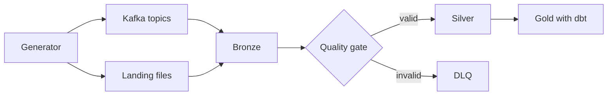

# Data Flow — Follow One Event Through the Code

> **Last Updated**: 2026-11-13 (2026-11-14: Airflow rows 19-19e verified on a running Airflow 3.0.6)
> **Purpose**: where each step of the pipeline lives, what goes in and out, and how to see the data.
> Target design: [ARCHITECTURE.md](ARCHITECTURE.md). Field-level rules: [DATA_CONTRACTS.md](DATA_CONTRACTS.md).
> **Rule**: updated at every day close. A step is ✅ only if its code exists and ran; 📋 steps are planned, and their paths may change.

**To understand a file**: open the file listed for a step and read its module docstring. To ask an AI assistant about it, paste the file together with the step's row from this table.

## Steps

| # | Step | Status | Code | In → out | See the data |
|---|---|---|---|---|---|
| 1 | Define what a valid event is | ✅ | [models.py](../src/lakehouse/contracts/models.py), [schemas/](../src/lakehouse/contracts/schemas/) | Pydantic models → JSON Schema files | `schemas/*.json` |
| 2 | Generate CDC events | ✅ | [cdc.py](../src/lakehouse/generator/cdc.py) `generate_cdc`, [config.py](../src/lakehouse/generator/config.py) | seed + config → events with planned defects | `python -m lakehouse.generator cdc --help` |
| 3 | Generate clickstream events | ✅ | [clickstream.py](../src/lakehouse/generator/clickstream.py) `generate_clickstream` | seed + config → events with planned defects | `python -m lakehouse.generator clickstream --help` |
| 4 | Record the expected outcome of every event | ✅ | [manifest.py](../src/lakehouse/generator/manifest.py) `classify_outcomes`, `expected_final_rows` | events → expected accepted, DLQ, duplicate, stale counts | [W1 lab notebook](../.claude/learning/labs/W1_lab.ipynb) (local) |
| 5 | Build Kafka key and headers | ✅ | [kafka.py](../src/lakehouse/contracts/kafka.py) `cdc_key`, `clickstream_key`, `cdc_headers`, `clickstream_headers`; [messages.py](../src/lakehouse/generator/messages.py) | event → key `{brand_id}:{entity_id}`, header `brand_id` | [week1-demo.md](runbooks/week1-demo.md) |
| 6 | Send to Kafka | ✅ | [producer.py](../src/lakehouse/generator/producer.py) `produce_messages`; CLI [\_\_main\_\_.py](../src/lakehouse/generator/__main__.py) | messages → topics `customer_cdc`, `clickstream_events` | [week1-demo.md](runbooks/week1-demo.md) |
| 7 | Start any Spark job | ✅ | [spark.py](../src/lakehouse/common/spark.py), [jobs.py](../src/lakehouse/common/jobs.py), [submit_job.py](../scripts/submit_job.py) | job name → run on the cluster, logs with `run_id` | Spark UI `127.0.0.1:8181` |
| 8 | Parse contract JSON in Spark | ✅ schema only | [spark_schema.py](../src/lakehouse/contracts/spark_schema.py) | contract → `StructType` | [test_spark_contract_schemas.py](../tests/spark/test_spark_contract_schemas.py) |
| 9 | Kafka → Bronze | ✅ | [bronze.py](../src/lakehouse/ingestion/bronze.py) `to_bronze_rows`, `write_bronze_batch`; [bronze_stream.py](../src/lakehouse/ingestion/jobs/bronze_stream.py) | message → one append-only row with raw value, lineage and `_parse_error`; tables at `s3a://lakehouse/bronze/raw_customers`, `raw_clickstream` (by path until the metastore, W2.D11). A rewound checkpoint fails the job (`CheckpointRewoundError`, D-050); restart behaviour in [ADR-0006](adr/0006-delivery-semantics-restart-and-checkpoint-loss.md) | `python scripts/submit_job.py bronze_report` (counts per table, parse-error code and tenant, `offsets_by_partition`, `distinct_lineages`; no raw values); [test_stream_restart.py](../tests/integration/test_stream_restart.py); [bronze_report.py](../src/lakehouse/ops/jobs/bronze_report.py) |
| 6a | Generate orders + products and land them as files | ✅ | [orders.py](../src/lakehouse/generator/orders.py) `generate_orders`, `customer_pools_from_cdc`; [products.py](../src/lakehouse/generator/products.py) `generate_products`; [landing.py](../src/lakehouse/generator/landing.py) `write_batch`, `write_products`; CLI `python -m lakehouse.generator land` | seed + config + the CDC customer pool → `landing/{brand}/orders/{date}/batch-NNNNN.ndjson` (one order per line, items embedded, `sales_channel` from batch 10) + `.manifest.json` (line count, sha256, defect per line), written data first, manifest last; products once per brand (D-070) | `python -m lakehouse.generator land --dry-run --out-dir build/landing` and open the NDJSON / manifest in VS Code; [test_landing.py](../tests/unit/generator/test_landing.py) |
| 9a | Landing files → Bronze | ✅ | [batch.py](../src/lakehouse/ingestion/batch.py) `to_bronze_rows`, `write_bronze_files`; [bronze_batch.py](../src/lakehouse/ingestion/jobs/bronze_batch.py) | new `*.ndjson` file → one append-only row per line in `bronze.raw_orders` / `raw_products`, `_source_ref` = `landing/...ndjson#L<n>`, `brand_id` from the path, payload brand in `payload_brand_id`, unparseable lines kept with `_parse_error`; `availableNow`, the checkpoint remembers processed files (D-071) | `python scripts/submit_job.py bronze_batch`; [test_bronze_batch.py](../tests/integration/test_bronze_batch.py) (rows per file = manifest line count) |
| 10 | Bronze → DLQ | ✅ | [rules.py](../src/lakehouse/quality/rules.py) `RULES_BY_TABLE`, `apply_rules`; [dlq_gate.py](../src/lakehouse/quality/jobs/dlq_gate.py) `post_write_problems` | parsed Bronze row failing a contract rule → one row in `s3a://lakehouse/dead_letter/dlq_customers`, `dlq_clickstream` with fixed rule codes, `_error_category`, `_bronze_ref`, `_retryable`, `_replay_status` (insert-only MERGE on `_dlq_id`; parse errors stay in Bronze, D-056/D-057) | `python scripts/submit_job.py dlq_gate`; `python scripts/submit_job.py dlq_report --list-refs` (counts by code, category, tenant; masked refs); [dlq_report.py](../src/lakehouse/ops/jobs/dlq_report.py); [test_dlq_reconciliation.py](../tests/integration/test_dlq_reconciliation.py) |
| 10a | Register tables by name | ✅ | [tables.py](../src/lakehouse/common/tables.py) `resolve`, `register_table`; [register_tables.py](../src/lakehouse/ops/jobs/register_tables.py); [render_hive_site.py](../docker/spark/render_hive_site.py) | Delta location written by a job → catalog entry `bronze.raw_*` / `dead_letter.dlq_*` in the Postgres-backed Hive metastore; readers (gate, reports, dbt) use the name; namespaced test runs stay path-based (D-060) | `python scripts/submit_job.py register_tables`; `docker exec crm_spark_thrift /opt/spark/bin/beeline -u jdbc:hive2://localhost:10000 -e "SHOW TABLES IN bronze"`; dbt probes `dbt_project/models/spike/` (`dbt build --select spike --profiles-dir profiles`), [ADR-0004](adr/0004-spark-dbt-ownership-and-adapter-capabilities.md) |
| 11 | Bronze customers → Silver customers | ✅ | [customers.py](../src/lakehouse/silver/customers.py) (dedup to max `_cdc_sequence`, guarded `MERGE`, tombstones); [pii.py](../src/lakehouse/common/pii.py) (HMAC `email_token`, phone last 4); job [silver_customers.py](../src/lakehouse/silver/jobs/silver_customers.py) | Bronze CDC row → one current row per `(brand_id, customer_id)`; stale/duplicate counted, invalid excluded | `python scripts/submit_job.py silver_customers`; `SELECT * FROM silver.customers` (no raw email/phone) |
| 11a | Bronze customers → SCD2 history | ✅ | [customers_history.py](../src/lakehouse/silver/customers_history.py); job [silver_customers_history.py](../src/lakehouse/silver/jobs/silver_customers_history.py) | affected keys rebuilt from the Bronze CDC log ordered by `_cdc_sequence` → versions with `valid_from`/`valid_to`/`is_current` | `silver.customers_history`; [test_scd2_history.py](../tests/integration/test_scd2_history.py) |
| 11b | Bronze orders → Silver orders + items | ✅ | [orders.py](../src/lakehouse/silver/orders.py); job [silver_orders.py](../src/lakehouse/silver/jobs/silver_orders.py) | landed order → `silver.orders` + exploded `silver.order_items` (first copy wins); FK orphans (customer/product, keyed with `brand_id`) → `dlq_orders` retryable | `silver.orders`, `silver.order_items`, `dead_letter.dlq_orders` |
| 11c | Bronze clickstream → Silver clickstream | ✅ | [clickstream.py](../src/lakehouse/silver/clickstream.py); job [silver_clickstream.py](../src/lakehouse/silver/jobs/silver_clickstream.py) | event → in-batch dedup + lookback-bounded `MERGE` on `(brand_id, event_id, event_date)`; `late_beyond_window` counted (D-079/D-086) | `silver.clickstream` (partitioned by `event_date`) |
| 11d | DLQ replay | ✅ | [replay.py](../src/lakehouse/quality/jobs/replay.py), [dlq.py](../src/lakehouse/quality/dlq.py) | retryable DLQ row whose parent now exists → Silver, DLQ row `REPLAYED`; otherwise `FAILED_AGAIN` (D-080) | `python scripts/submit_job.py replay`; `_replay_status` in `dead_letter.dlq_orders` |
| 12 | Reconcile counts | ✅ | [metrics.py](../src/lakehouse/ops/metrics.py) (`ops.pipeline_metrics`, one row per Silver micro-batch); [reconcile.py](../src/lakehouse/quality/jobs/reconcile.py) | batch rows + data totals → bronze = accepted + dlq + duplicates + stale + late per batch and per `(table, brand)`; non-zero exit on mismatch (D-081/D-082) | `python scripts/submit_job.py reconcile`; Delta path `s3a://lakehouse/ops/pipeline_metrics` (not registered in the catalog) |
| 12a | Content hash (re-run proof) | ✅ | [hashing.py](../src/lakehouse/common/hashing.py), [content_hash.py](../src/lakehouse/ops/jobs/content_hash.py) | table → order-independent hash, lineage columns excluded (D-083/D-084) | `python scripts/submit_job.py content_hash --table customers` |
| 12b | Tenant isolation check + scoped views | ✅ | [isolation.py](../src/lakehouse/quality/isolation.py), [isolation_check.py](../src/lakehouse/quality/jobs/isolation_check.py), [views.py](../src/lakehouse/silver/views.py), [register_tenant_views.py](../src/lakehouse/ops/jobs/register_tenant_views.py) | Silver → per-brand views `v_<table>__<brand>`; counts per brand, leaky-join detector (D-085) | `python scripts/submit_job.py isolation_check --expected-json '{...}'` |
| 13 | Silver → staging (dbt) | ✅ | [_silver__sources.yml](../dbt_project/models/staging/_silver__sources.yml), [models/staging/](../dbt_project/models/staging/) `stg_*.sql`, [_stg__models.yml](../dbt_project/models/staging/_stg__models.yml) | Silver table → one view per table in `gold_staging`, rename/cast only, no raw names (D-088) | `cd dbt_project; ..\.venv-dbt\Scripts\dbt build --select staging --profiles-dir profiles`; `SELECT * FROM gold_staging.stg_customers` |
| 13a | Tenant-safe dbt tests | ✅ | [relationships_by_brand.sql](../dbt_project/tests/generic/relationships_by_brand.sql), [cross_tenant_key_matches.sql](../dbt_project/macros/cross_tenant_key_matches.sql), [assert_no_cross_tenant_joins.sql](../dbt_project/tests/singular/assert_no_cross_tenant_joins.sql); fixtures [models/tenant_fixtures/](../dbt_project/models/tenant_fixtures/), [tests/tenant_fixtures/](../dbt_project/tests/tenant_fixtures/) | child FK → parent in the **same brand**; a match only in another brand is a failure (D-089) | `pytest tests/integration/test_dbt_tenant_tests.py -q` (leaky fixture: plain `relationships` 1 failure, `relationships_by_brand` 2) |
| 11e | Bronze products → Silver products | ✅ | [products.py](../src/lakehouse/silver/products.py), [silver_products.py](../src/lakehouse/silver/jobs/silver_products.py) | `bronze.raw_products` → latest valid copy per `(brand_id, product_id)` → MERGE `silver.products` (D-094) | `python scripts/submit_job.py silver_products`; beeline `select brand_id, count(*) from silver.products group by brand_id` |
| 14 | Staging → Gold dimensions and facts | ✅ W4.D20 | [models/marts/dims/](../dbt_project/models/marts/dims/), [models/marts/facts/](../dbt_project/models/marts/facts/), [brand_surrogate_key.sql](../dbt_project/macros/brand_surrogate_key.sql), [assert_marts_reconcile_to_staging.sql](../dbt_project/tests/singular/assert_marts_reconcile_to_staging.sql) | `gold_staging.stg_*` → `gold_marts.dim_*` / `fct_*` Delta tables (D-095) | `cd dbt_project; ..\.venv-dbt\Scripts\dbt build --select staging marts --profiles-dir profiles`; beeline `select * from gold_marts.fct_orders limit 10` |
| 15 | Gold → Customer 360 and RFM | ✅ W4.D21 | [obt_customer_360.sql](../dbt_project/models/marts/analytics/obt_customer_360.sql), [agg_rfm_segments.sql](../dbt_project/models/marts/analytics/agg_rfm_segments.sql), [rfm_segment.sql](../dbt_project/macros/rfm_segment.sql), [tenant_scoped_views.sql](../dbt_project/macros/tenant_scoped_views.sql), [_analytics.yml](../dbt_project/models/marts/analytics/_analytics.yml) (tests + unit tests) | `dim_customers` + `fct_orders` + `fct_sessions` up to `var('as_of_date')` → one row per `(brand_id, customer_id)`; buyers → NTILE(5) R/F/M per brand → segment; views `gold_tenant.<model>__<brand>` (D-097) | `dbt build --select +agg_rfm_segments --profiles-dir profiles`; `gold_marts.obt_customer_360`, `gold_marts.agg_rfm_segments`; `python scripts/check_dbt_docs.py` after `dbt docs generate` |
| 15a | Audited clickstream reset (ops, not a pipeline step) | ✅ W4.D21 | [reset_clickstream.py](../src/lakehouse/ops/jobs/reset_clickstream.py) | dry run lists the clickstream Bronze/DLQ/Silver locations, checkpoints and metrics rows; `--apply --confirm clickstream` removes exactly those (D-097) | `python scripts/submit_job.py reset_clickstream` |
| 15b | One-command end-to-end run (no Airflow) | 🔄 W4.D24.1 (processing chain verified; `land` needs the owner's S3 credentials) | [run_e2e.py](../scripts/run_e2e.py) | produce → land → Bronze → DLQ (all four tables) → Silver → reconcile → `dbt build` (D-100) | `python scripts/run_e2e.py --dry-run`; `python scripts/run_e2e.py [--skip-generate]` |
| 16 | Ops metrics report (local and Glue) | 🔄 W5.D30.1 (host tests; Spark test not run) | [metrics_report.py](../src/lakehouse/ops/jobs/metrics_report.py), [report.py](../src/lakehouse/ops/report.py) | latest `reconcile` row per (table, brand) + batch-term sums + Bronze freshness/lag → markdown/JSON under `--output-uri/<run_id>/`; mismatches are reported, not raised | `submit_job.py metrics_report --output-uri s3a://lakehouse/ops/reports` |
| 17 | Cloud path: artefacts → Glue jobs (AWS) | 🔄 W5.D27 (code; never run on AWS) | [build_artifacts.py](../scripts/cloud/build_artifacts.py), [glue_entry.py](../scripts/cloud/glue_entry.py), [run_job.py](../scripts/cloud/run_job.py), [seed_bronze.py](../scripts/cloud/seed_bronze.py), [infra/terraform](../infra/terraform/) | wheel + entry → `artifacts/<sha12>/`; `land` with empty `S3_ENDPOINT` → AWS landing; Kafka-sourced Bronze copied from local (D-101); Glue: register_tables → bronze_batch → dlq_gate → Silver → reconcile → metrics_report (D-103) | [aws-owner-setup.md](runbooks/aws-owner-setup.md) |
| 18 | Gold on Athena | 🔄 W5.D28.4 (parses; never run on Athena) | [register_athena_silver.sql](../dbt_project/macros/register_athena_silver.sql), [profiles.yml](../dbt_project/profiles/profiles.yml) | Silver Delta registered in `athena_silver` → same staging/marts models with dbt-athena → Hive/Parquet under `gold/` (D-104) | `dbt build --target athena --select staging marts` |
| 19 | Airflow image and services | ✅ image `crm/airflow:3.0.6` built and running (2026-11-14) | [Dockerfile](../docker/airflow/Dockerfile), [requirements-airflow.txt](../docker/airflow/requirements-airflow.txt), [docker-compose.yml](../docker-compose.yml) `airflow-*` | Airflow 3.0.6 + Java 17 + the cluster's Spark 3.5.9 client + dbt venv → `orchestration` profile (init, api-server, dag-processor, scheduler) (D-098) | UI `http://127.0.0.1:8080` after the build |
| 19a | Pipeline DAG | ✅ green end to end incl. `dbt_build` (W4.D22.2) | [lakehouse_pipeline.py](../dags/lakehouse_pipeline.py); Airflow-free logic in [orchestration/](../src/lakehouse/orchestration/) (`plan.py`, `submit.py`, `joblog.py`) | params `brands`, `fail_brand`, `max_dlq_rate` → plan → landing check → Bronze → `dlq_gate` → Silver → `reconcile` → DLQ-rate gate → `dbt build`; Spark jobs run in client mode, result = exit code + JSON log ([ADR-0010](adr/0010-orchestration-compute-interface.md)) | Airflow UI, task logs |
| 19b | Per-brand landing check | ✅ live (W4.D23.1) | [landing.py](../src/lakehouse/orchestration/landing.py) `check_brand_landing` | `landing/{brand_id}/{orders,products}/` → brand healthy when each entity has a `*.manifest.json`; mapped per brand (`.expand`) so one brand failing does not stop the others | task `landing_check`, map index = brand position |
| 19c | DLQ-rate gate | ✅ live breach halts `dbt_build` (W4.D23.2) | [dlq_rate.py](../src/lakehouse/quality/dlq_rate.py), [dlq_rate_gate.py](../src/lakehouse/quality/jobs/dlq_rate_gate.py) | per brand and source: pending DLQ rows ÷ parseable Bronze rows; above `--max-dlq-rate` → job fails naming the brands → `dbt_build` halts (D-099) | log events `dlq_rate_gate.report` / `dlq_rate_gate.breach` |
| 19d | Failure and threshold alert | ✅ both payload kinds seen live (W4.D23.3, D-107) | [alert.py](../src/lakehouse/orchestration/alert.py) `build_alert_payload`, `emit_alert`; `alert_on_failure` in the DAG | failed task or breach → one JSON payload (no PII), logged as `ALERT_PAYLOAD {...}` and POSTed to `ALERT_WEBHOOK_URL` only if set (D-099) | task log of the failed task |
| 19e | Failure isolation and backfill tests | ✅ isolation + gate 7 passed, backfill 1 passed (W4.D23.1, W4.D23.4) | [test_dag_failure_isolation.py](../tests/integration/test_dag_failure_isolation.py), [test_backfill_idempotent.py](../tests/integration/test_backfill_idempotent.py), [airflow_cli.py](../tests/integration/airflow_cli.py) | `fail_brand=brand_beta` → beta fails, alpha/gamma succeed, run red; same past date twice → identical `content_hash` of the Silver tables | `pytest tests/integration/test_dag_failure_isolation.py -q` (skips without the Airflow container) |

## Rules that hold across steps

- `brand_id` is part of every business key and join.
- Bronze keeps everything; nothing is dropped silently.
- CDC order comes from `_cdc_sequence`, never from wall-clock time.
- Money and timestamps stay strings until Silver checks and casts them (D-045).
