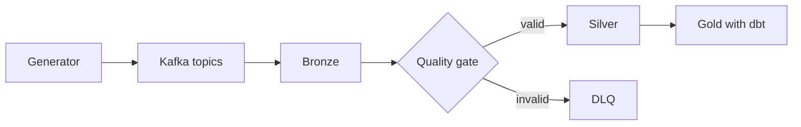

# Data Flow — Follow One Event Through the Code

> **Last Updated**: 2026-11-09 (through W2.D8)
> **Purpose**: where each step of the pipeline lives, what goes in and out, and how to see the data.
> Target design: [ARCHITECTURE.md](ARCHITECTURE.md). Field-level rules: [DATA_CONTRACTS.md](DATA_CONTRACTS.md).
> **Rule**: updated at every day close. A step is ✅ only if its code exists and ran; 📋 steps are planned, and their paths may change.

**To understand a file**: open the file listed for a step and read its module docstring. To ask an AI assistant about it, paste the file together with the step's row from this table.

## Steps

| # | Step | Status | Code | In → out | See the data |
|---|---|---|---|---|---|
| 1 | Define what a valid event is | ✅ | [models.py](../src/lakehouse/contracts/models.py), [schemas/](../src/lakehouse/contracts/schemas/) | Pydantic models → JSON Schema files | `schemas/*.json` |
| 2 | Generate CDC events | ✅ | [cdc.py](../src/lakehouse/generator/cdc.py) `generate_cdc`, [config.py](../src/lakehouse/generator/config.py) | seed + config → events with planned defects | `python -m lakehouse.generator cdc --help` |
| 3 | Generate clickstream events | ✅ | [clickstream.py](../src/lakehouse/generator/clickstream.py) `generate_clickstream` | seed + config → events with planned defects | `python -m lakehouse.generator clickstream --help` |
| 4 | Record the expected outcome of every event | ✅ | [manifest.py](../src/lakehouse/generator/manifest.py) `classify_outcomes`, `expected_final_rows` | events → expected accepted, DLQ, duplicate, stale counts | [W1 lab notebook](../.claude/learning/labs/W1_lab.ipynb) (local) |
| 5 | Build Kafka key and headers | ✅ | [kafka.py](../src/lakehouse/contracts/kafka.py) `cdc_key`, `clickstream_key`, `cdc_headers`, `clickstream_headers`; [messages.py](../src/lakehouse/generator/messages.py) | event → key `{brand_id}:{entity_id}`, header `brand_id` | [week1-demo.md](runbooks/week1-demo.md) |
| 6 | Send to Kafka | ✅ | [producer.py](../src/lakehouse/generator/producer.py) `produce_messages`; CLI [\_\_main\_\_.py](../src/lakehouse/generator/__main__.py) | messages → topics `customer_cdc`, `clickstream_events` | [week1-demo.md](runbooks/week1-demo.md) |
| 7 | Start any Spark job | ✅ | [spark.py](../src/lakehouse/common/spark.py), [jobs.py](../src/lakehouse/common/jobs.py), [submit_job.py](../scripts/submit_job.py) | job name → run on the cluster, logs with `run_id` | Spark UI `127.0.0.1:8181` |
| 8 | Parse contract JSON in Spark | ✅ schema only | [spark_schema.py](../src/lakehouse/contracts/spark_schema.py) | contract → `StructType` | [test_spark_contract_schemas.py](../tests/spark/test_spark_contract_schemas.py) |
| 9 | Kafka → Bronze | ✅ | [bronze.py](../src/lakehouse/ingestion/bronze.py) `to_bronze_rows`, `write_bronze_batch`; [bronze_stream.py](../src/lakehouse/ingestion/jobs/bronze_stream.py) | message → one append-only row with raw value, lineage and `_parse_error`; tables at `s3a://lakehouse/bronze/raw_customers`, `raw_clickstream` (by path until the metastore, W2.D11). A rewound checkpoint fails the job (`CheckpointRewoundError`, D-050); restart behaviour in [ADR-0006](adr/0006-delivery-semantics-restart-and-checkpoint-loss.md) | `python scripts/submit_job.py bronze_report` (counts per table, parse-error code and tenant, `offsets_by_partition`, `distinct_lineages`; no raw values); [test_stream_restart.py](../tests/integration/test_stream_restart.py); [bronze_report.py](../src/lakehouse/ops/jobs/bronze_report.py) |
| 10 | Bronze → DLQ | ✅ | [rules.py](../src/lakehouse/quality/rules.py) `RULES_BY_TABLE`, `apply_rules`; [dlq_gate.py](../src/lakehouse/quality/jobs/dlq_gate.py) `post_write_problems` | parsed Bronze row failing a contract rule → one row in `s3a://lakehouse/dead_letter/dlq_customers`, `dlq_clickstream` with fixed rule codes, `_error_category`, `_bronze_ref`, `_retryable`, `_replay_status` (insert-only MERGE on `_dlq_id`; parse errors stay in Bronze, D-056/D-057) | `python scripts/submit_job.py dlq_gate`; `python scripts/submit_job.py dlq_report --list-refs` (counts by code, category, tenant; masked refs); [dlq_report.py](../src/lakehouse/ops/jobs/dlq_report.py); [test_dlq_reconciliation.py](../tests/integration/test_dlq_reconciliation.py) |
| 11 | Bronze → Silver | 📋 W3.D14–D17 | `src/lakehouse/silver/` | valid row → `MERGE` by `_cdc_sequence`, SCD2 | added at D14 |
| 12 | Reconcile counts | 📋 W3.D18 | `src/lakehouse/ops/` | layer counts → bronze = accepted + dlq + duplicates + stale + late | added at D18 |
| 13 | Silver → Gold | 📋 W4.D19–D21 | `dbt_project/` | Silver → dimensions, facts, Customer 360, RFM | added at D19 |

## Rules that hold across steps

- `brand_id` is part of every business key and join.
- Bronze keeps everything; nothing is dropped silently.
- CDC order comes from `_cdc_sequence`, never from wall-clock time.
- Money and timestamps stay strings until Silver checks and casts them (D-045).
