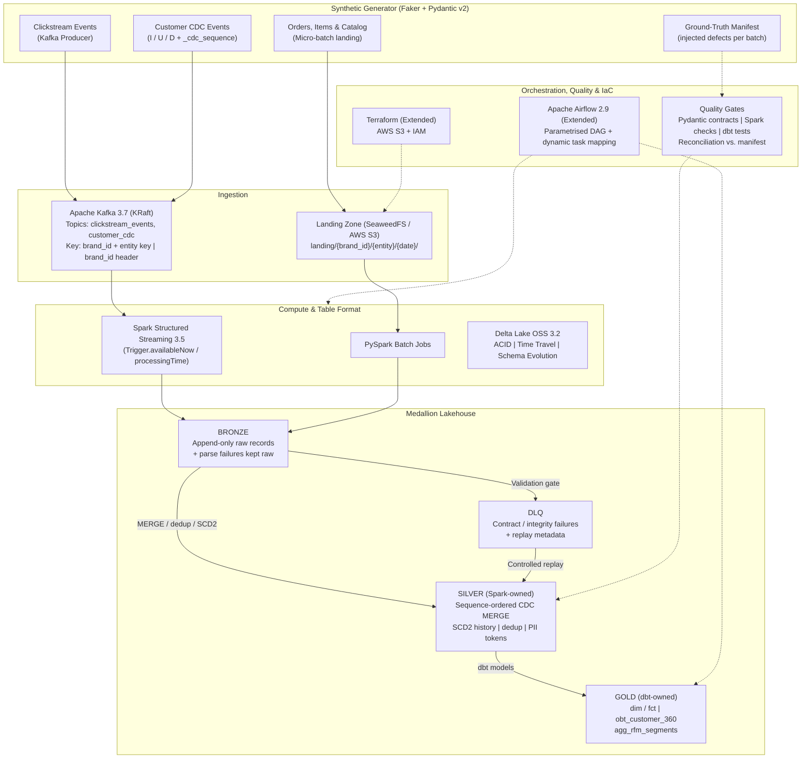

# Project Charter: Multi-Tenant CRM Lakehouse Platform

> **Document Version**: 7.0  
> **Last Updated**: 2026-10-20  
> **Author & Architect**: Ömer Faruk Doğru — Senior Data / Analytics Engineer (Berlin)  
> **Status**: 🟡 ACTIVE — Week 1 in progress. Architecture baselined; most components are **planned, not yet implemented** (see [PROGRESS.md](PROGRESS.md)).  
> **Target Roles**: Senior Data Engineer — Berlin (large-scale e-commerce, delivery and fintech data platforms)

> [!NOTE]
> **How to read this document**: Everything here is *design intent* unless it is linked to evidence (commit, test, benchmark) in [PROGRESS.md](PROGRESS.md). Numbers without evidence are labelled as **targets** or **hypotheses**, never as results.

---

## 1. Executive Summary & Vision

The **Multi-Tenant CRM Lakehouse Platform** is a portfolio-grade, local-first data platform that ingests synthetic clickstream, order and customer CDC events for multiple tenant brands, processes them with Spark Structured Streaming and Delta Lake, and models analytical marts with dbt.

The focus is **correctness under realistic failure modes** — duplicate delivery, out-of-order CDC, late events, schema drift, restarts and cross-tenant leakage — rather than the number of services deployed.

### Data Disclaimer
All data is **fully synthetic**, produced by `src/generator/` (Faker + Pydantic v2). The entity model is inspired by the *TheLook* e-commerce domain (hence the repository name) and reshaped into a multi-brand CRM event model. No real company, customer or TheLook dataset records are used.

### The Engineering Problems It Demonstrates
- Turning **at-least-once** streams into **idempotent** tables.
- Applying **out-of-order CDC** correctly (sequence-ordered, never wall-clock-ordered) and keeping **SCD Type 2** history.
- Preventing — and **proving the absence of** — cross-tenant data leakage in shared tables.
- Quarantining bad records **and replaying them** without loss or duplication.
- Running the same transformation logic locally and on AWS, and **documenting what differs**.

### Scope Tiers

| Tier | Content | Planned Weeks |
|---|---|---|
| **Core (MVP vertical slice)** | Generator → Kafka → Spark Structured Streaming → Bronze + DLQ → Silver (CDC MERGE, dedup, SCD2) → dbt Gold → correctness tests; Docker local stack | W1–W3 |
| **Extended** | Benchmarks, Airflow orchestration, backfill, quality gates, GitHub Actions CI (unit + integration), Terraform (S3 + IAM) and one Spark/Delta job against AWS S3 | W4–W6 |
| **Stretch** | Databricks Auto Loader + Asset Bundles, Great Expectations, churn feature mart | W6, only if Core + Extended are verified |
| **Out of scope (v1)** | Kinesis implementation (ADR comparison only), Reverse ETL / Lambda triggers, live dashboards, MWAA, Kubernetes, Flink, TCO comparisons against real vendors | — |

> [!IMPORTANT]
> A tier only starts when the previous tier's acceptance tests pass. Features are never advertised in the README before they are verified.

### Strategic Philosophy: "Local-First, Cloud-Deployable"
1. **Reproducible locally at $0**: `docker compose up -d` starts Apache Kafka 3.7 (KRaft), Apache Spark 3.5.1, Delta Lake OSS 3.2.0, SeaweedFS (S3-compatible API), PostgreSQL and Apache Airflow 2.9.3. Setup time and hardware requirements will be **measured on a clean machine** and published; until then no setup-time claim is made.
2. **Shared logic, separate adapters — not "identical environments"**: Business logic (parsing, validation, dedup, CDC merge, SCD2) lives in environment-agnostic Python modules. Environment specifics (storage endpoint, credentials, catalog, trigger mode, file source vs. Auto Loader) are isolated in configuration and thin adapters.
   - SeaweedFS's S3 API is **not** AWS S3 (IAM, encryption, listing and error behaviour differ).
   - OSS Spark/Delta is **not** the Databricks runtime (versions, connectors, available Delta features differ).
   - Test results are therefore **reported per environment** (local vs. AWS).

---

## 2. Target Architecture

---

## 3. Architecture Invariants (Non-Negotiables)

1. **Bronze is an append-only logical record**: Normal processing never executes `UPDATE` or `DELETE` in Bronze. Every record carries ingestion metadata (`_ingest_ts`, `_source_ref`, `_batch_id`, `brand_id`). **Sole exception**: the documented privacy erasure procedure (§5), executed as an audited rewrite and logged in `ops.erasure_log`. Bronze retention is configurable and documented.

2. **No silent data loss — every record is accounted for**:
   - *Parse failures* (malformed JSON, missing envelope) are captured **at Bronze ingest** as raw strings with `_parse_error`.
   - *Contract / integrity failures* are captured **at the Bronze → Silver gate** into `dead_letter.dlq_*`. The DLQ references the original Bronze record via `_bronze_ref`; the original payload stays in Bronze.
   - *Intentional removals* (duplicates, events beyond the dedup window) are **counted as metrics**, never dropped invisibly; the records remain in Bronze.
   - Reconciliation invariant per batch: `input = bronze`, and `bronze = silver_accepted + dlq + duplicates_removed + late_beyond_window`, checked against the generator's ground-truth manifest.

3. **Tenant isolation is tested, not assumed**: `brand_id` is mandatory, non-null and part of **every business key and every join condition**. Tables are shared across tenants, so physical partitioning is a **performance choice, not a security boundary**. Isolation is demonstrated through: (a) composite keys including `brand_id`; (b) automated tests with deliberate cross-tenant key collisions; (c) tenant-scoped consumption views; (d) in AWS, prefix-scoped IAM policies as a demonstration. Not in v1: per-tenant encryption keys or row-level security engines.

4. **Delivery semantics are explicit per stage** (no blanket "exactly-once" claim):

   | Stage | Guarantee | Mechanism |
   |---|---|---|
   | Generator → Kafka | At-least-once | Idempotent producer (`enable.idempotence=true`) limits retry duplicates; generator *intentionally* injects business duplicates |
   | Kafka → Bronze | Each Kafka offset committed once per checkpoint lineage | Spark checkpoint + Delta sink's idempotent batch commit. Bronze may still contain business duplicates and, after checkpoint loss, offset re-reads |
   | Bronze → Silver | Idempotent outcome | `foreachBatch` + `MERGE` on deterministic keys; re-running the same batch yields the same table state |
   | Silver → Gold | Deterministic | dbt incremental with `unique_key` or full refresh |
   | Checkpoint loss | Recoverable | Replay from Kafka (within retention); Silver `MERGE` absorbs re-reads — verified by test |

5. **CDC is ordered by sequence, not wall clock**: Each CDC event carries `_cdc_sequence`, monotonic per `(brand_id, customer_id)` (simulating a source LSN). An event with `_cdc_sequence ≤` the current Silver sequence never overwrites state. `_cdc_ts` is informational and used for SCD2 validity timestamps only.

6. **Single owner per dataset**: Spark/Delta owns Bronze, DLQ and Silver — including customer current state **and** SCD2 history. dbt owns Gold only; it reads Silver and never writes it. **No dbt snapshots on customers** (that would create a second, competing history source).

7. **Privacy controls, not a compliance claim**: PII is pseudonymised in Silver (§5); raw PII never reaches Gold. The repository demonstrates controls; it does **not** claim legal GDPR compliance.

---

## 4. Business Domain & Data Entities

The platform models a synthetic omni-channel retail scenario with a configurable number of tenant brands (demo default: 3–5).

| Entity | Ingestion | Transport | Kafka Message Key | Business / Dedup Key | Ordering Field | Initial Partitioning* |
|---|---|---|---|---|---|---|
| `customers` | Streaming CDC (I/U/D) | Kafka `customer_cdc` | `{brand_id}:{customer_id}` | `(brand_id, customer_id, _cdc_sequence)` | `_cdc_sequence` | none (small table) |
| `clickstream_events` | Stream | Kafka `clickstream_events` | `{brand_id}:{session_id}` | `(brand_id, event_id)` | `event_timestamp` | `event_date` |
| `orders` | Micro-batch | S3 landing | — | `(brand_id, order_id)` | `_ingest_ts` | `brand_id` |
| `order_items` | Micro-batch | S3 landing | — | `(brand_id, order_id, item_id)` | `_ingest_ts` | `brand_id` |
| `products` | Seed / daily batch | S3 landing | — | `(brand_id, product_id)` | `_ingest_ts` | none |

\* Partitioning is **not an invariant**. Initial choices are validated against measured file counts and tenant distribution and finalised in ADR-0005.

**Keying rationale**: Using `brand_id` alone as Kafka key would funnel a dominant tenant (see the 80% skew scenario) into a single partition. Composite keys preserve the ordering that actually matters (per customer for CDC, per session for clickstream) while spreading load. `brand_id` is additionally sent as a message header for routing and filtering. `event_id` is a UUIDv4 by generator contract, but dedup keys still include `brand_id` defensively.

---

## 5. Privacy & Retention Design

| Control | Design |
|---|---|
| **Pseudonymisation** | `email_token = HMAC-SHA256(key, lower(trim(email)))`, computed in Spark Silver. The key comes from an environment variable / secret store and is never committed. Plain SHA-256 is avoided because low-entropy values (emails, phones) are reversible by dictionary attack. HMAC tokens remain *pseudonymous* personal data. |
| **Masking** | Phone reduced to last 4 digits in Silver; raw phone/email never reach Gold. |
| **CDC delete (`D`)** | Silver row kept as tombstone (`is_deleted = true`); `email_token`, phone and other PII set to `NULL`. |
| **Erasure request** | Audited procedure: rewrite the subject's records in Bronze (documented exception), Silver and Gold; run `VACUUM` after the retention window so old file versions are physically removed; log in `ops.erasure_log`. |
| **Limits (documented)** | `VACUUM` is file hygiene, not proof of erasure by itself. Time travel, Kafka topic retention, streaming state stores and downstream copies are covered explicitly in the procedure. |

---

## 6. Technology Stack Mapping (CV Alignment)

| Target Skill | Platform Implementation | Proof Location (planned) | Tier |
|---|---|---|---|
| **Kafka streaming** | Keyed partitioning, idempotent producer, consumer lag, replay from offsets | `src/generator/kafka_producer.py`, `tests/integration/` | Core |
| **Spark Structured Streaming** | Checkpointing, `foreachBatch` MERGE, restart/replay tests | `src/streaming/`, `tests/integration/` | Core |
| **Delta Lake OSS** | ACID, schema evolution, `MERGE INTO`, time travel, `OPTIMIZE`/`ZORDER`, `VACUUM` | `src/streaming/` | Core |
| **CDC & SCD2** | Sequence-ordered merge, out-of-order handling, Spark-owned SCD2 history | `src/streaming/silver_customers*.py` | Core |
| **dbt Core** | Kimball Gold marts, composite-key tests, contracts (if supported by adapter) | `dbt_project/` | Core |
| **Data quality & contracts** | Pydantic v2 contracts, validation gate, DLQ + replay, reconciliation vs. manifest | `src/quality/`, `docs/DATA_CONTRACTS.md` | Core |
| **Spark performance** | AQE vs. salting on skewed joins, broadcast joins, Z-Order — **measured** | `docs/benchmarks.md` | Extended |
| **Orchestration (Airflow)** | Parametrised DAG with dynamic task mapping, backfill, failure alerts | `dags/` | Extended |
| **CI/CD** | Ruff, mypy, pytest unit (offline) + integration job (Docker), dbt compile | `.github/workflows/ci.yml` | Extended |
| **Infrastructure as Code** | Terraform: S3 buckets, prefix-scoped IAM, lifecycle rules, SSE | `infra/terraform/` | Extended |
| **Databricks** | Auto Loader + Asset Bundles as second deployment target | `notebooks/`, `databricks.yml` | Stretch |

---

## 7. Success Criteria (Evidence-Based)

Ordered by hiring value; each item is only "done" with linked evidence in PROGRESS.md:

1. **Working end-to-end vertical slice** — one command runs Generator → Kafka → Bronze → Silver → Gold; integration test passes.
2. **Correctness tests** — CDC ordering, idempotent replay & restart, tenant isolation (including a negative test that proves leaks are detected), DLQ replay.
3. **Measured performance & recovery** — following the methodology in §8.
4. **Clean CI and reproducible local setup** — green CI run linked; setup time and hardware measured on a clean machine.
5. **Cloud deployment** — Terraform-provisioned S3/IAM plus one Spark/Delta job verified on AWS; differences documented.
6. **ADRs** that articulate trade-offs (§9).

Line coverage ≥ 80% on `src/generator/` is a **hygiene floor**, not a quality claim; correctness and integration tests take priority.

---

## 8. Benchmark Methodology

No percentage improvement is committed in advance. Every benchmark records:
- Fixed dataset (generator seed, row counts, tenant distribution) and machine spec (CPU, RAM, Docker allocation).
- Spark configuration (including AQE settings), 1 warm-up run + 5 measured runs.
- p50 / p95 runtime, throughput, file count, shuffle bytes, max/median task time.
- Before/after comparison and an explanation **even when no improvement occurs**.
- A note that local-scale results do not prove production-scale behaviour.

---

## 9. Planned Architecture Decision Records

| ADR | Topic | Status |
|---|---|---|
| ADR-0001 | Local object storage with SeaweedFS | ✅ Written |
| ADR-0002 | Kafka (implemented) vs. Kinesis (compared only); common event envelope | ⏳ |
| ADR-0003 | Append-only Bronze and the erasure exception | ⏳ |
| ADR-0004 | Spark vs. dbt ownership boundary (Silver/Gold, SCD2 owner, dbt adapter capabilities) | ⏳ |
| ADR-0005 | Multi-tenant isolation model and partitioning | ⏳ |
| ADR-0006 | Delivery semantics, idempotency and replay | ⏳ |

---

## 10. Known Risks & Open Questions

| Risk | Mitigation |
|---|---|
| Scope creep across too many components | Tier gating (§1); Stretch items dropped first |
| Local resource footprint (Kafka + Spark + Airflow + Postgres + SeaweedFS) | Measure; introduce Docker Compose profiles if needed |
| dbt-spark via Thrift Server + Delta + metastore compatibility | Capability spike on Day 13; fallback to dbt-spark `session` method |
| Databricks trial window and cost | Stretch tier; record actual spend from billing, destroy resources after proof |
| Local results misread as production evidence | Per-environment reporting; methodology caveats in benchmarks |
